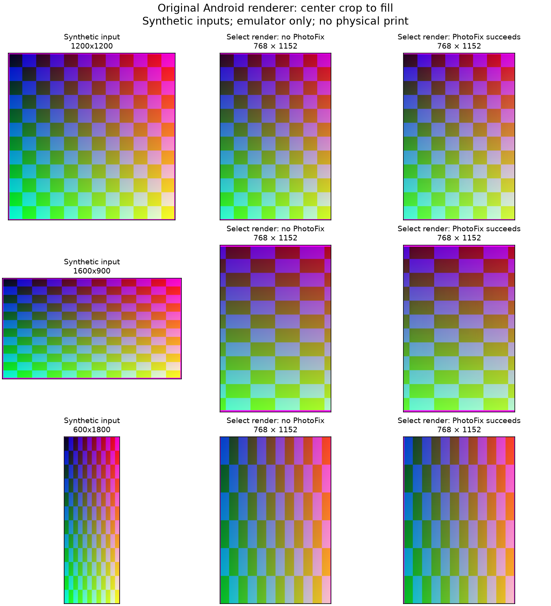

# Isolated Android rendering experiment

2026-10-21 local / 2026-10-22 UTC. The two-hour ceiling was not needed: the
original compiled renderer was callable without rooting an emulator, modifying
the vendor APK, launching its application, or connecting to a printer.

## Result and evidence boundary

**72 completed cases** exercised the Select renderer and full BasicPrintService
preprocessing method: three input routes × six dimensions × two PhotoFix states
× two native-pointer configurations. All produced **768 × 1152 JPEGs with quality
argument 90**. Each full `processData` output matched the separately captured
render-plus-compress bytes. There were no case errors.

This is execution of original vendor DEX and native libraries in an isolated
Android harness. It is stronger than decompilation alone, but **not a full HP app
UI workflow or physical printer test**. Input starts at the transformed-image or
bitmap-override boundary. Earlier gallery loading, EXIF orientation handling,
editor rotation/cropping, user layout choices, and queue orchestration are outside
this experiment. No physical printer connections, print requests, image uploads,
or paper-consuming operations occurred.

- Reproducible harness: [experiments/android-render](experiments/android-render/README.md).
- Machine-readable results and SHA-256 for each captured JPEG:
  [summary.json](experiments/android-render/evidence/summary.json).
- Synthetic-image comparison:
  [render-comparison.png](experiments/android-render/evidence/render-comparison.png).
- APK identity/provenance: [NEWER_APK.md](NEWER_APK.md).

## Isolation and setup

A new `Zink_Research` AVD used the already installed Android 16/API 36 arm64
Play Store image. Existing personal AVDs were not used or altered. Emulator
version was 36.1.9.0 (build 13823996); system fingerprint:
`google/sdk_gphone64_arm64/emu64a:16/BE2A.250530.026.D1/13818094:user/release-keys`.
No root, Frida, vendor repackaging, Android Studio installation, or additional
system-image download was necessary.

The base APK 3.0.2921.1 / 74251 and its arm64, English, and xxxhdpi splits were
installed only in that AVD. The HP application was not launched. Our independent,
debuggable `dev.zink.renderprobe` app loaded the installed package's classes with
`createPackageContext(INCLUDE_CODE | IGNORE_SECURITY)`, then used reflection to
call its original methods. The vendor Application.onCreate and transport clients
were not invoked. GrandBahamaDevice was created with a null Bluetooth device.

The harness manifest requests **no permissions**, including no Bluetooth, network,
camera, or shared-storage permission. Emulator Bluetooth, Wi-Fi, and mobile data
were disabled. No host Bluetooth controller was bridged into the emulator. All
fixtures are generated color ramps/checker patterns, with no personal photographs.
Outputs live in the harness's own files directory and were copied with `run-as`.
The research emulator was shut down after capture; its dedicated AVD is retained
for reproducibility. The macOS probe and physical printer settings were untouched.

The harness targets API 35 because that local compile platform is installed; the
vendor APK targets API 36. Both run on Android 16. This difference, harness
context/resources, and skipped vendor app initialization are explicit limits on
extrapolating behavior to the full production app.

## Geometry: center crop, without automatic rotation at this stage

Routes exercised:

1. A bitmap supplied directly as the preprocessing override.
2. A transformed PNG file with the Lanczos feature enabled (the clean-preference
   default observed in the first complete run was true).
3. The same file route with the feature disabled, using the matrix renderer.

For every fixture and PhotoFix setting, the three routes produced identical JPEG
bytes. This equality is specific to this artifact, emulator, and fixture set.
The current `cropImage` implementation already draws into a target-size canvas
before calling native Lanczos resize with the same dimensions. Thus the native
call's presence does not mean these fixtures receive a distinct downsampling pass.

The runtime logs and output pixels agree with center-crop-to-fill:
`scale = max(768 / source_width, 1152 / source_height)`, centered in both axes.
The top raster inset was zero. There were no letterbox borders or aspect-ratio
stretching in these opaque inputs. A landscape input stayed landscape in pixel
orientation and lost its sides; this stage did not rotate it to fit.

| Input | Output | Effective source area retained, before resampling |
| --- | --- | --- |
| 768 × 1152 | 768 × 1152 | Entire image, no geometry change |
| 1200 × 1200 | 768 × 1152 | Center 800 × 1200; 200 pixels removed from each side |
| 1600 × 900 | 768 × 1152 | Center 600 × 900; 500 pixels removed from each side |
| 600 × 1800 | 768 × 1152 | Center 600 × 900; 450 pixels removed from top and bottom |
| 96 × 144 | 768 × 1152 | Entire image, 8× proportional scaling; no padding |
| 1536 × 2304 | 768 × 1152 | Entire image, 0.5× downscaling |

A debug string saying `cropRect=none(letterbox-fit)` in PreprocessPrintService is
misleading for this artifact: its called ImageUtil method and executed output
show center cropping. Do not infer geometry from that string alone. Likewise,
these results do not exclude an earlier editor adding its own border or rotation
before passing a transformed bitmap to this stage.



## PhotoFix: observed failure and successful native enhancement

The caller skips PhotoFix when ImageData is already marked enhanced. Otherwise it
attempts PhotoFix but ignores the returned boolean and logs `applied=true` even
when enhancement fails. Both branches were exercised.

| Harness configuration | Native handle sign | Direct PhotoFix result | Requested-enhancement output |
| --- | --- | --- | --- |
| Default pointer tagging | Negative | BAD_HANDLE | Identical to enhancement-skipped output |
| `allowNativeHeapPointerTagging=false` on the harness only | Positive | SUCCESS | Pixels changed; dimensions unchanged |

PhotoFix's Java wrapper rejects `libHandle <= 0` before applying enhancement.
The controlled manifest change switched the handle sign and result while leaving
the vendor APK and native libraries unchanged. This strongly supports a signed
handle / tagged-pointer compatibility problem in this environment. Android's
[official pointer-tagging documentation](https://source.android.com/docs/security/test/tagged-pointers)
explains the top-byte tag and the per-application opt-out used for this diagnostic.
This was not a system-wide security setting change and is not offered as a general
production fix.

The inspected vendor manifest does not explicitly opt out of pointer tagging.
However, **we have not established whether the full HP app on a specific physical
phone reaches this failure**; its initialization, OS configuration, and other
compatibility settings can differ. No native pointer values were edited.

In the successful configuration, the synthetic fixtures' mean absolute RGB channel
change ranged from about **0.49 to 7.87** on a 0–255 scale. The largest individual
channel change was **38**. These are numerical changes on artificial patterns,
not a measurement of photographic improvement or printed color accuracy.
For the 768 × 1152 fixture, the JPEG grew from **42,309 to 49,206 bytes** after
successful enhancement. All 18 requested-enhancement cases in each full run had
an additional direct result check: BAD_HANDLE in the default run, SUCCESS in the
opt-out run. That direct check used a copy and did not alter the captured output.

## JPEG and resolution metadata

Captured final payloads were baseline JPEG, 768 × 1152, with 4:2:0 chroma
subsampling. The compression argument was 90, confirmed both by the original
method's runtime value and the matching full-process output. Representative
luminance quantization values begin `3, 2, 2, 3, 5, 8, 10, 12`.

The representative payload contains a **456-byte sRGB ICC profile**, JFIF 1.01,
unit 0, density 1 × 1. **Unit 0 means no physical density unit**; it does not say
1 DPI. No EXIF tags were present in these generated-fixture outputs. Dimensions,
subsampling, absent EXIF, and JFIF unit 0 were checked across all 72 JPEGs.
The color-profile details describe the sampled synthetic sRGB pipeline; wide-gamut
inputs and arbitrary source metadata were not tested.

This makes the input-resolution distinction clearer: this executed preparation
path supplies pixel dimensions but does not encode the printer's published
321 × 600 DPI as JPEG physical-density metadata. It still does not establish the
print-head grid, firmware scaling algorithm, or acceptance of other JPEG sizes.

Diagnostic `PrintRenderTraceUtil` dumps use JPEG quality 95. Those trace images
are not the final transmitted payload. This experiment separately saved lossless
rendered PNGs and the exact quality-90 bytes returned by preprocessing.

## Offline message serialization

The original message serializers were invoked on in-memory buffers only. No
MessageClient, queue, transport, or device exchange was created.

For a synthetic 42,309-byte JPEG, PrintStartRequestMessage produced:

```text
0c 01 45 a5 00 00
│  │  └───────── 42309 as uint32 little-endian
│  └──────────── file type 1
└─────────────── PRINT_START_REQ
```

The message contains no DPI, width, or height field. The dimensions are in the
JPEG itself. This is the serialized command body, not a complete Bluetooth frame
or proof of firmware acceptance.

For illustrative job ID `0x1234`, one copy, name `OFFLINE`, the original job-property
serializer produced `30 34 12 03 01 01 07 4f 46 46 4c 49 4e 45`: command 0x30,
job ID LE, field 3/copies 1, field 1/name length 7/name bytes. These are synthetic
values, not the properties of a real submitted job. Other optional job properties
and the full queue sequence were not dynamically exercised.

## Other model profile check

The original enum was also evaluated at runtime. It confirmed **640 × 1002** for
NONE/IMPULSE/MAUI/IBIZA/CLASSIC/HP200/HP200D; **768 × 1152** for BAHAMA and
GRAND_BAHAMA; **793 × 972** for HP400; **800 × 1100** for HP500;
**1232 × 1786** for HP600; and **1224 × 1836** for LUZON. Quality was 90 except
LUZON's 70. This resolves the decompiler's numeric aliases for this APK, but does
not establish which profiles every retail device's active workflow selects.
See [NAMING_AND_DEVICE_FAMILIES.md](NAMING_AND_DEVICE_FAMILIES.md).

## What remains untested

- Full HP app UI, original-photo orientation/editor behavior, user settings, and
  real queue orchestration.
- Physical-phone reproduction of the PhotoFix handle failure.
- Transparent, wide-gamut, malformed, or extremely large image inputs; EXIF-rich
  source images; all PhotoFix optional modes and natural-photo quality.
- Bluetooth transfer of these bytes, different-size JPEG acceptance, physical
  dot resolution, color calibration, paper placement, or printing.

The result is a reusable offline way to interrogate the vendor implementation.
The next focused extension could compare the same inputs against the older APK
or exercise upstream orientation/layout handling. Physical print validation
remains a separately authorized milestone.

## Follow-up: earlier editor stage

[EDITOR_PIPELINE.md](EDITOR_PIPELINE.md) now traces and executes the preview model
and fit/fill view. It confirms upstream portrait normalization, white borders,
and a 1000 × 1500 intermediate for the 96 × 144 fresh-source case. The full app
UI lifecycle remains outside the measured harness.
