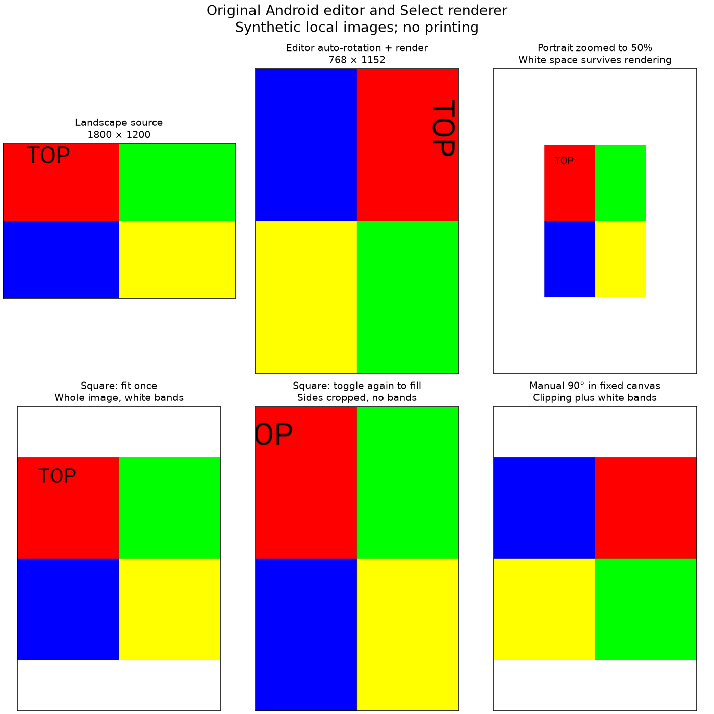

# Offline editor, rotation, cropping, and borders

2026-10-22. Follow-up to [ANDROID_RUNTIME.md](ANDROID_RUNTIME.md), using the same
unmodified Android APK 3.0.2921.1 / 74251 and original compiled classes. The
experiment stayed offline in the dedicated Android 16 ARM64 research emulator.
No HP app startup, printer transport, queue submission, image upload, or physical
print was invoked. PhotoFix was marked already applied so that this experiment
isolates geometry rather than enhancement.

## The small-image answer

The previous renderer-only **96 × 144 → 768 × 1152** result was proportional
**8× scaling in both axes**, with filtering/interpolation. It was not letterboxing:
those dimensions share the same 2:3 aspect ratio, so no padding or cropping was
needed. Upscaling adds samples, not recovered photographic detail.

The earlier editor introduces an additional resampling step. With a fresh source
and no existing transformed file, its measurement/preparation routine enlarges
images whose shorter side is below 1000 pixels. In our executed small-image case:

```text
96 × 144 source → 1000 × 1500 editor intermediate → 768 × 1152 Select bitmap
```

The first scale is approximately 10.4167×; the final reduction is 0.768×. The net
size change is still 8×, but a two-stage resampling pipeline need not produce the
same pixels as direct enlargement. This minimum-size branch applies to the
fresh-source route; an already transformed file follows another branch.

## What was executed

The extended harness completed **38 cases without errors**:

- Five input sizes: 1200 × 1800, 1800 × 1200, 1200 × 1200, 96 × 144, and
  1024 × 1536. For each: identity, half-scale, double-scale, 90° manual rotation,
  and a 100-pixel horizontal preview translation (25 cases).
- One and two calls to the original InteractiveImageView.fitOrFill method for
  portrait, landscape, and square inputs (six cases).
- EXIF orientation values 2–8 on an asymmetric portrait fixture (seven cases;
  orientation 1 is already covered).

Each case ran the original preview-model measurement, edit-save method, and
Select createPrintBitmap renderer. Output pixels were captured at intermediate
and final stages. Fit/fill tests also instantiated the original view on the
Android main thread and forwarded its reset/scale callbacks to the original
view model, matching the relevant DefaultPreviewFragment listener behavior.

The harness used a 400 × 600 preview, local JPEG fixtures, an independent Android
Application/context, and a synthetic null-Bluetooth Select object. It called the
measurement method synchronously, then flushed main-thread LiveData updates.
It did not drive the complete gallery/editor UI, gesture recognizers, or app
lifecycle. Direct transform tests exercise the model's methods; they do not prove
that every UI gesture permits the same displacement without spring-back.

Artifacts:

- [Editor harness](experiments/android-render/src/dev/zink/renderprobe/EditorExperiment.java)
- [Analysis script](experiments/android-render/analyze_editor.py)
- [38-case evidence summary](experiments/android-render/evidence/editor-summary.json)
- [Visual comparison](experiments/android-render/evidence/editor-comparison.png)

## Recovered path into the Select renderer

The source call chain connects these components:

1. ImagePreviewUtil loads a local image into InteractiveImageView for preview.
2. DefaultPreviewFragmentViewModel prepares an intermediate image and tracks
   edits in a matrix. Preview callbacks forward rotation, scale, translation,
   and reset actions into that model.
3. DefaultPreviewFragment.drawBitmap → drawImageBitmap → viewModel.drawTo saves
   the transformed image into ImageData.
4. PrintImageManager.getPreProcessData places ImageData and its ImageViewSource
   into PreprocessPrintServiceData. The ordinary image route uses BasicPrintService.
5. PreprocessPrintService reads the transformed file, produces the Select's
   768 × 1152 bitmap, optionally attempts PhotoFix, and compresses at quality 90.

These are recovered call relationships, not a claim that the harness ran the
presenter or queue machinery. The HP600-specific preview-snapshot route is
separate; finding a screenshot method in that route does not establish Select's
ordinary input is always a screen-resolution screenshot.

## Rotation happens at more than one stage

The preview model's preparation routine reads EXIF orientation from the source
URI. In the tested file-URI route it applies:

| EXIF value | Explicit rotation in this model |
| --- | --- |
| 3 | 180° |
| 6 | 90° |
| 8 | 270° |
| 1, 2, 4, 5, 7 | No explicit orientation transform in this routine |

After that, if width still exceeds height, it applies **another 90° rotation**
to make the intermediate portrait. Thus our untagged 1800 × 1200 landscape source
became a 1200 × 1800 portrait intermediate, before the final renderer saw it.
This is different from directly feeding a landscape override into the renderer,
which center-crops without automatically rotating it.

On the asymmetric 1200 × 1800 portrait fixture, EXIF 3 and 6 yielded a net 180°
change; EXIF 8 yielded a net 360°/unchanged result after the portrait-normalizing
step. Tags 2, 4, 5, and 7 did not mirror the fixture in this model route.

**Limit:** this is not a diagnosis of all gallery/import behavior. ImagePreviewUtil
also uses Glide/Picasso and has separate rotation hints and pre-cut branches.
ExifUtil.rotateBitmap has a different switch that handles mirrored orientations,
but that helper is not called by the measured preparation routine. Other loaders
may normalize metadata before reaching it. A complete UI test with content URIs
is needed before claiming a user-visible EXIF bug.

Manual rotation subsequently applies to the fixed intermediate canvas. Rotating
our 1200 × 1800 image by 90° about its center did not swap the output canvas to
1800 × 1200. It clipped the now-wide image and left white bands above and below.
Those bands remained in the final Select bitmap.

## Cropping versus borders

ImageUtil.getTransformedBitmap creates a canvas of the measured intermediate
width/height, fills it **opaque white**, and draws the source through the editor
matrix. This explains both clipping and white borders:

| Operation | Observed behavior |
| --- | --- |
| Identity, matching 2:3 source | Full image; no added white border |
| Scale 0.5 about center | Image occupies a quarter of canvas area; approximately 75% white area remains |
| Scale 2 about center | Magnified image clipped by the canvas; no added border in our fixture |
| Translate +100 preview pixels in a 400-pixel-wide preview | Image moves right by 25% of the canvas; a white strip appears on the left |
| Rotate 90° in a portrait canvas | Horizontal clipping and white top/bottom bands |
| Fit a square once | Whole square retained, with white top/bottom bands after final rendering |
| Toggle the square again | Returns to fill; sides crop and white bands disappear |

For the square, the view's initial fill matrix had scale 0.5 and horizontal offset
−100 at 400 × 600. One fit toggle applied a 2/3 relative scale. The model's
1200 × 1200 intermediate contained an 800 × 800 centered picture with white
surrounding space. The renderer's later center crop removed the left/right white
space while preserving top/bottom bands: approximately **192 pixels per band**
in the final 768 × 1152 output. The near-white pixel fraction was about 33.2%
(the exact threshold measurement is affected by resampling/JPEG edge pixels).
A second toggle restored the identity model matrix and the cropped fill result.

DefaultPreviewFragment.handleImageLoadedSuccess calls fitOrFill when the view
reports a square or transformations are disabled. This supports square-fit as an
intended path, but the harness only tested the original view/model methods with
a controlled initial state, not every lifecycle or saved-setting combination.

Borders here are image pixels already present before final rendering. The later
renderer can center-crop a bordered intermediate and still preserve some or all
of its borders. Therefore “the renderer uses cover/center crop” does not mean
“the final app output can never contain white borders.”



## Intermediate format and decompiler corrections

The recovered Java for drawChangesToFile was initially an undecompiled stub.
A fallback instruction dump showed the calls to getTransformedBitmap and
changeBackgroundColor; execution of the original DEX completed successfully.
We did not reimplement or execute the decompiled stub.

The original ImagePreviewUtil writer uses JPEG quality **100** but names the
saved intermediate with a **`.png` suffix**. All 38 captured edited files had
JPEG magic bytes `ff d8 ff` despite that suffix. The final render decodes their
content correctly. There is therefore a quality-100 JPEG intermediate before
the final quality-90 JPEG, rather than a guaranteed lossless PNG intermediate.
Our captured PNGs are independent lossless diagnostic snapshots after decoding.

The decompiled measurement code visually suggested integer division for preview
scale factors. Runtime disproved that interpretation: a 1024 × 1536 intermediate
in a 400 × 600 preview produced **2.56** for both scale factors, not 2. Avoid
turning suspicious decompiler expressions into bug claims without verification.

The decode helper's 2048 naming is also not a hard maximum-size guarantee. Its
power-of-two sampling rule depends on both dimensions. It should not be treated
as a promise that every intermediate is at most 2048 pixels on its long side.

## Decorative editor and margin-mask boundaries

Static tracing found a further optional EditImageActivity under `com.custom.sdk`:
DefaultPreviewFragment's Edit action clears its printer-margin overlay, captures
the current preview container into a bitmap, and passes an image URI to that
activity. The activity has crop/rotation controls and a separate border/frame
image layer, including adjustable alpha, then returns an edited URI, dimensions,
and an isImageEdited flag. PreviewActivity forwards the result to the presenter.
These routes can bake additional framing/cropping into the next preview input.

That full decorative editor was **not launched or exhaustively tested**. This
report's measured white borders come from preview fit/transform operations, not
from exercising its downloadable frame library or every decorative control.

The inspected DefaultPreviewFragment.setMarginForPrinterNew method is empty.
Other mask helpers and a 40%-white overlay resource exist, but their presence
alone does not establish active printer margins. No physical margin size is
inferred from these UI names. The observed render top inset remains zero.

## Reproduction and limits

Build/install the harness as in [its README](experiments/android-render/README.md).
Run with `--es run editor-fit --ez editorOnly true`, wait for completion, and
capture `files/results-editor-fit` with `run-as` from the research emulator only.
Run analyze_editor.py against the extracted directory to reproduce the summary
and figure. The normal default pointer-tagging build is sufficient because
PhotoFix is intentionally skipped in these geometry cases.

The analysis asserts all 38 cases succeeded, final size is 768 × 1152, edited
payloads are JPEG, the small-input intermediate is 1000 × 1500, fractional scale
factors remain fractional, and the observed fit/white-area/orientation results
match the recorded evidence. Raw captures and vendor binaries stay ignored.

Still untested: full UI lifecycle, actual pinch/pan spring-back, content-provider
EXIF import, the complete custom decorative editor, video/collage/pre-cut modes,
physical-phone parity, and all printer/physical-paper behavior. The emulator was
shut down after the experiment. No supported-device claims or probe permissions
were broadened.
