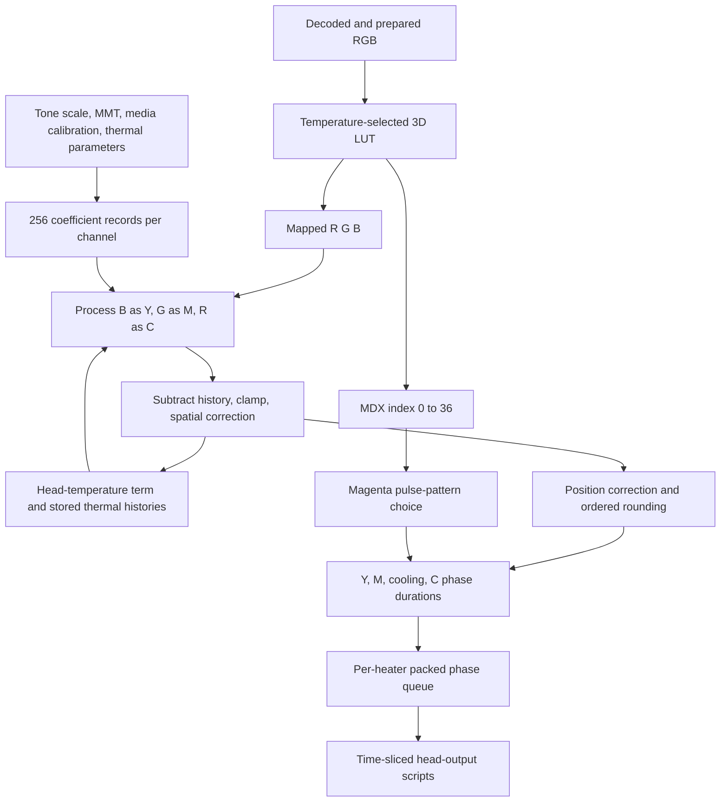

# From mapped RGB and MDX to thermal-head schedules

2026-10-23. Follow-up to [LUT selection and factory-path research](FIRMWARE_LUT_TRACE.md).

The downloaded **G1L1FS2105AR** program converts mapped RGB into four tone/thermal
coefficients per channel, subtracts heat-history terms, applies a spatial
correction, and schedules alternating on/off patterns for each heater position.
The fourth LUT component, **MDX**, selects the magenta phase's pulse distribution.
It does not carry a fourth dye amount or a raw heater amplitude.

The important new distinction is between **amount**, **history**, and **timing**.
The same mapped pixel can request different heating after different preceding
pixels/color phases. The requested amount can then be distributed differently
over time by its MDX index and by the cyan phase's available time budget.

This investigation was entirely offline. No printer connection, print, setting
change, factory mode, or firmware update occurred. CAL-03 is unchanged and
unprinted. Only analysis code, small numerical summaries, and documentation are
published; firmware, complete extracted tables, and raw device records remain
in ignored local storage.

## Evidence and confidence

The hash-pinned package is `G1L1FS2105AR_1.0.7.rbn`, SHA-256
`68cc7a635342e1e882b1e552c9d1ee2803b1c5928d61a0612f69e689d9f08a60`.
Inflated main image SHA-256:
`4cc83261d16ab8078db3a38ae694017c26e6c681e1eca1e9bb41a437704c24ce`.
Acquisition and scatter loading are documented in the preceding reports.

The physical Select reported **G1L1FA2105AR**. This is an implementation trace of
the available FS build, not proof of instruction-for-instruction equivalence to
that FA unit. The matched FA/FS comparison from another printer family supports
related color resources but does not eliminate this boundary.

Addresses below are **inflated-file offsets**, except those explicitly marked
RAM or MMIO. Traced code runs at file offset minus `0xc0`.

| Stage | Evidence this turn | Remaining boundary |
|---|---|---|
| Tone/MMT/thermal resources to three coefficient tables | Complete builder executed in ARM; independent Python matches all 3,072 uint16 coefficients | Neutral media-calibration fixture; not the actual unit's calibration |
| Per-pixel heat subtraction and spatial correction | ARM/Python match on 4,830 pixels in 30 synthetic rows | Histories supplied as fixtures; not a complete page simulation |
| Fast heat-state recurrence and lateral diffusion | ARM/Python match on 9,702 state values in 36 cases | Slower multiscale state scheduling and interpolation traced statically |
| MDX patterns and regenerated duty patterns | All 37 MDX occupancy relations checked; 33 generator cases match ARM | No electrical head capture |
| Y/M/C amounts to phase list | Static control/data-flow trace | Complete planner, clipping, and cooling-policy branches not independently emulated |
| Phase list to per-heater ring | ARM/Python match in 103 cases, including wrap and exact-fill | Final-heater RTOS notification excluded |
| Ring to head-output script | Static consumer and MMIO setup trace | Script engine, DMA/pins, voltage/current and physical timing not emulated |

The reproducible runner is [trace_thermal.py](experiments/firmware/trace_thermal.py),
with [recorded results](experiments/firmware/thermal-trace-results.json).

## 1. Pipeline and channel order



The row worker calls `0x37308` three times at `0x2b558..0x2b588`, passing B,
then G, then R and the three coefficient-table pointers. Builder diagnostic
labels at `0x2c2ec..0x2c30c` explicitly identify Y, M, C. These are **mapped**
components after the 3D color LUT, not necessarily the original JPEG components.

Y/M/C label processing phases. They do not establish that a nominal RGB cyan,
magenta, or yellow patch activates only one physical dye layer.

## 2. Tone processing produces coefficients, not final pulse counts

The builder at `0x2c564..0x2d064` combines `TONESCALE`, `MMT`, `ZINK_THC`, and
media-calibration parameters into three 256-entry tables. Each entry is four
unsigned 16-bit coefficients, eight bytes total. Pointers are stored at RAM
`0x14db20+0x6c`, `+0x70`, and `+0x74`.

For each channel, four 256-float MMT planes become 256 four-float records with
the sample axis reversed. Calibration can adjust those records before the tone
scale is applied. The retained reference covers a **neutral fixture**: each
channel's seven calibration fields are `[1,0,0,0,0,0,0]`, with remaining fields
zero. It preserves the builder's float32 rounding even for its nominally neutral
gain operation. Actual per-media/per-unit calibration and non-neutral branches
have not been reconstructed in full.

For byte `i`, the tone lookup uses the channel's component of the tone triplet
and computes a continuous MMT index:

```text
x = float32((float64(tone[i][2-channel]) - 0.05)
            * float64(float32(255 / 2.45)))
```

The scale is `104.08163452148438`. Inside `0..255`, all four MMT fields are
linearly interpolated. Outside that range, the first field is extrapolated
linearly while the other fields are held at the nearest endpoint. This is not
simply `255 - component` followed by a power-law gamma curve.

Let the interpolated fields be `E, T, B, D`, let `t=min(T,0)`, and let `a,b,d`
come from channel offsets `0x0c/0x10/0x14` in `ZINK_THC` (88-byte channel stride).
The neutral path computes approximately:

```text
s = t / (1 + a*t)
gain = 1 - a*s

a0 = round_and_clamp((64 / scale) * max(gain*E, 0))
a1 = round_and_cap((-4096 / scale) * s)
a2 = round_and_clamp(-4096 * (B - b*t) * gain)
a3 = round_and_clamp(-4096 * (D - d*t) * gain)
```

Here `scale` is the resource's float at `+0x110`, approximately `0.0477051884`.
These equations summarize the algebra; the executable reference preserves each
float32 operation and exact rounding/clipping. Names `E/T/B/D` are descriptive
local notation, not authoritative physical units or recovered field names.

Example **neutral-fixture** records:

| Channel | Mapped component byte | a0 | a1 | a2 | a3 |
|---|---:|---:|---:|---:|---:|
| Y | 0 | 6285 | 1862 | 742 | 766 |
| Y | 128 | 3940 | 1894 | 698 | 744 |
| Y | 255 | 3076 | 1952 | 680 | 717 |
| M | 128 | 8750 | 4738 | 5220 | 1663 |
| C | 128 | 15518 | 15536 | 3477 | 3362 |

The nonzero entry at byte 255 is **not** evidence that white is commanded to
print dark: these are intermediate coefficients, and temperature/history terms
are subtracted before any heating duration is scheduled.

## 3. Thermal history changes the requested amount

At `0x37440..0x37530`, for each component byte the firmware reads its four
coefficients and calculates:

```text
theta = head_scalar - reference_offset + history0[x] + history1[x]

raw[x] = clamp(
    signed32((a0 << 14) - theta*a1
             - previous_raw[x]*a2 - older_raw[x]*a3) >> 12,
    0, channel_limit)
```

Products/subtractions wrap at 32 bits before the arithmetic right shift. Treating
them as arbitrary-precision Python integers without that wrap gives wrong
answers for some stress fixtures.

The channel-parameter records are at RAM `0x2a0780 + channel*48`. The recovered
limits are Y=`100<<8`, M=`200<<8`, C=`255<<8`; initialization at
`0x3769c..0x376c0` reads `[100,200,255]` and shifts each by eight. The reference
offset in this fixture is `10240` (`40*256`); the independently evolving head
scalar is supplied separately. This trace does not claim those integers are
directly measured joules, temperature degrees, or pulse counts.

The `previous_raw` and `older_raw` buffers are swapped after **each color-phase
call**, at `0x375ac..0x375b8`. They should not be described as simply two previous
image rows. The Y/M/C calls share thermal state, so successive color phases as
well as preceding image rows influence the result.

### Spatial compensation versus spreading in the history model

After the raw calculation, `0x37530..0x375ac` applies:

```text
output[x] = clamp(raw[x] +
                  ((k * (2*raw[x] - raw[x-1] - raw[x+1])) >> 12),
                  0, channel_limit)
```

The nominal fixture gives `k=12,37,121` for Y,M,C. The first left neighbor is
zero; the last right neighbor is the allocated guard value. The Python reference
also preserves signed 32-bit multiplication/addition behavior. This is an
edge-emphasizing correction, not the diffusion step described next.

At `0x375c8..0x375d4`, the corrected output is accumulated into slower history
state and the **fast history update** at `0x37158` runs. For its scale-zero path,
the central values follow:

```text
h1[x] = ((drive * output[x] + decay * old_h[x]) modulo 2^32) >> 16
h2[x] = h1[x] + (spread * (h1[x-1] + h1[x+1] - 2*h1[x]) >> 16)
```

The second line is an algebraic summary; the implementation uses a wrapped
32-bit product, logical shift and final uint16 storage. Guard locations receive
decay without new output. Endpoint diffusion uses zero outside the buffer.

| Phase | drive | decay | spread |
|---|---:|---:|---:|
| Y | 4935 | 63920 | 11796 |
| M | 4579 | 59308 | 14417 |
| C | 3480 | 45068 | 17694 |

These fixed-point coefficients are generated by the neutral builder fixture;
they are not measured physical time constants. The same history buffer advances
after each Y, M, C call using the corresponding phase's coefficients.

The slower paths aggregate output over spatial groups (`0x37064`), update
coarser heat buffers at reduced cadence (`0x37308..0x3743c`), and interpolate
them back toward heater resolution (`0x37c1c`, `0x37d14`). Their code supports a
multiscale heat model, but its complete cadence, startup/priming, sensor feedback,
and page-long behavior have not been execution-validated here.

**Implication for the photographed chart:** the code has explicit mechanisms
for residual heat, lateral spread, and compensation. That supports the proposed
thermal explanation as plausible. It does not identify which mechanism caused
the cyan-looking edges or directional contrast loss in a phone photograph.
Capture effects, mapping, calibration, paper chemistry, and imperfect compensation
remain alternatives or contributing factors.

## 4. MDX selects pulse occupancy, not a percent-on value

The table at RAM `0x14e2f0` has eight-byte entries:

```text
uint32 logical_on_mask
uint16 repeat_length
uint8  duty_numerator
uint8  divider
```

For every one of the 37 fixed MDX patterns:

```text
on_fraction = popcount(mask) / repeat_length = divider / duty_numerator
phase_duration = floor(requested_M_count * duty_numerator / divider)
```

Thus the previously recovered duty/divider is an **inverse occupancy ratio**.
It expands the time spent in the magenta phase while distributing on-slots
through that time. For example, MDX 18 uses four on-slots in a 28-slot cycle,
equivalent to **one in seven**. Ignoring phase-boundary and budget effects, a
request for 100 on-slots becomes a 700-slot phase, approximately 100 of them on.

| MDX | Mask | Cycle length | On bits | Duration multiplier | On fraction |
|---|---|---:|---:|---:|---:|
| 0 | `0x88888888` | 32 | 8 | 4 | 1/4 |
| 17 | `0x04081020` | 27 | 4 | 27/4 | 4/27 |
| 18 | `0x08102040` | 28 | 4 | 7 | 1/7 |
| 36 | `0x20080200` | 30 | 3 | 10 | 1/10 |

This relation establishes logical occupancy, not absolute heat energy: pulse
placement, thermal state, voltage, finite phase endings, and clipping matter.
Physical bit order and active electrical polarity were not measured.

Some additional pattern entries are **regenerated during setup** at
`0x2d2d0..0x2d34c`; inspecting only their initial ROM values would be misleading.
The shipped `ZINK_THC` bytes at `+0x120/+0x121` are **7 and 14**. They configure
fallback M pattern 39 at 1/7 and C patterns 40..46 at **1/14 down to 1/8**.
The generator `0x36d28` sets bits at `duty-1, 2*duty-1, ...` below bit 32 and
sets cycle length to `floor(32/duty)*duty`. It caps the interval at 31; zero is
outside the valid fixture domain. Pattern 47 is configured separately for preheat.

## 5. Amounts become a phase list for each heater position

The normal printing branch of `0x2aba8` reads the three uint16 thermal outputs,
three position-correction values, a 4×4 ordered-rounding matrix, and MDX.
At `0x2ad50..0x2adfc` and `0x2b054..0x2b088`, the initial counts use:

```text
count = (((position_correction >> 2) * thermal_output
          + (dither << 17)) modulo 2^32) >> 21
```

The matrix, indexed by row/column modulo four, is:

```text
10   2   8   0
 6  14   4  12
 9   1  11   3
 5  13   7  15
```

With a synthetic unity correction of 32768 this is approximately
`thermal_output/256` plus an ordered fractional rounding term. The actual
position-correction resource is not replaced by that unity fixture in normal
firmware. Cyan's initial count is capped at 255.

At `0x2b19c..0x2b260`, zero-length phases are omitted and the list has this order:

| Phase | Pattern ID | Meaning |
|---|---:|---|
| Y | 38 (`0x26`) | All-on pattern, duration from the Y count |
| M | MDX 0..36, or fallback 39 | Duration scaled by the selected inverse occupancy |
| Cooling gap | 37 (`0x25`) | All-off pattern |
| C | 40..46 | Low occupancy pattern selected to fit available time |
| Optional second C segment | Adjacent C pattern | Mix adjacent intervals when using adaptive timing |

The worker reserves eight slots from its line budget before planning. The
surrounding code limits M, derives a cooling interval from runtime parameters
and the Y request, and may select progressively denser C patterns if C would
not fit. It can split C between adjacent patterns or clamp it. Remaining-time
placement also depends on a policy field. These branches are statically traced,
not a validated, complete Python phase planner; a simple duration multiplier is
insufficient to reproduce every boundary case.

## 6. Concrete command representation and hardware handoff

`0x36730` packs each phase into a 32-bit **internal** word:

```text
bits  0..11: duration in MiniT slots
bits 16..21: pattern ID
other bits: zero in this writer

word = ((pattern_id & 0x3f) << 16) | (duration & 0xfff)
```

There is a 31-entry phase ring for each heater position, with a 136-byte record
containing three bookkeeping words and the ring. The writer appends an ID-37
off phase to consume any remaining line budget, then advances to the next
heater. The last heater signals the downstream worker.

An **illustrative synthetic** list with budget 1024:

```text
Y on 100       -> 0x00260064
MDX 18 for 70  -> 0x00120046
Off 20         -> 0x00250014
C ID 40 for 120-> 0x00280078
Off remainder  -> 0x002502ca  (714 slots)
```

This example tests packing only. It is not a measured pixel's command stream,
not a universal line budget, and not a packet sent over Bluetooth.

The consumer at `0x3403c..0x34684` reads these phase rings, tracks positions within
the repeating masks, splits work into up-to-1024-slot chunks, and constructs
head-output scripts with pattern and destination-buffer references. The path
continues through the script submitter (`0x81518`) and engine control
(`0x36dc0`, including MMIO `0xf0000430`). This reaches an internal hardware
interface rather than a printer-protocol command that the host can simply send.

Setup at `0x32698` writes `0x01000004` to MMIO `0xf0000030` and logs
`TPH CLK 20MHz config`. Its MiniT getter `0x31ed4` returns the float at file
`0x32194`: **6.800000190734863 microseconds**. These are different quantities:
20 MHz is a head-interface clock configuration; 6.8 microseconds is the
software's thermal time quantum. A 1024-slot chunk corresponds nominally to
6.9632 ms; it is not, by itself, proof of a complete image-row duration or feed
speed. No oscilloscope/logic-analyzer or physical timing verification was done.

This scheduling gives a concrete reason why different color exposure times
can coexist with apparently continuous paper motion: heating is divided into
small electronic time slots. It does not require a visible mechanical pause
for every color-heavy part of the image. That is an inference from the recovered
scheduler, not a fresh measurement of the physical Select.

## Reproduction and validation

Use Python 3.11+ and Unicorn 2.1.4 in a separate research environment. The default
Apple Python 3.9 is below the project's supported version. No new production
dependency is added.

```sh
python -m unittest discover -s experiments/firmware -v
python experiments/firmware/trace_thermal.py \
  logs/color-firmware-research/G1L1FS2105AR_1.0.7.rbn > thermal-results.json
```

Results: **23 synthetic tests pass**; all comparisons in the evidence table
match. Synthetic rows cover widths 1, 2, 3, 31 and 768 for the pixel loops,
nominal and full-uint16 stress coefficients, saturation, signed wrap, and nonzero
right guards. Fast-history fixtures include decay-only guards and widths 2, 31,
768. Queue fixtures cover empty/all-off, exact fill, ring wrap, and 100 seeded
random valid cases. Pattern generation tests intervals 1..33, including the cap.

The runner restricts executed code ranges and bounds instructions/time. It maps
no peripherals. Stubbed services are a neutral media-calibration fetch,
allocation/free, logging, unsigned division's quotient/remainder helper, and
thermal-buffer initialization. Fast-history and pixel-loop state is supplied
explicitly; hardware/RTOS completion is not simulated. Exact input hashes are
checked before execution. The committed JSON records scope and stub counts.

## What this changes for a portable driver

The evidence strongly supports keeping temperature-dependent color and heater
timing **inside the printer**. A desktop driver should deliver the established
JPEG representation and manage transport/job state. Applying this thermal/LUT
processing to the host image would risk double correction and would lack the
printer's live history, sensors, and calibration.

We can now explain a concrete route from RGB and MDX to heater schedules, but
cannot yet predict a whole physical print or certify a pure-dye diagnostic patch.
Remaining research includes exact FA firmware, actual media calibration,
multiscale-state initialization and recurrence, complete phase-planner behavior,
hardware-script semantics, voltage/current, and timing under real operation.

For a usable Mac/Linux/Windows driver, the higher-return engineering step remains
the [portable job engine and simulated-printer tests](DRIVER_ROADMAP.md).
This firmware work is useful explanatory and diagnostic evidence, rather than
a prerequisite to reimplementing the printer's internal thermal controller.
