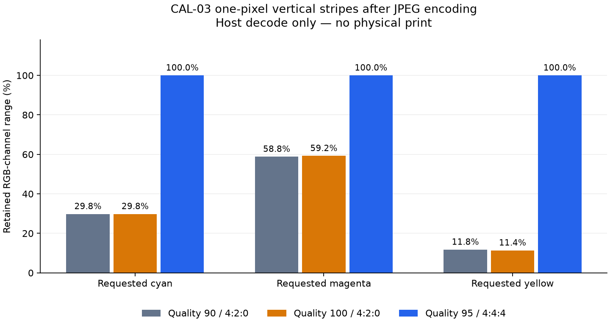

# JPEG quality and accepted image headers

2026-10-23. Offline follow-up to the [tone-to-heater trace](FIRMWARE_THERMAL_TRACE.md).

**4:4:4 JPEG is a promising driver option.** The recovered FS2105 firmware has
explicit sampling configurations for it, and its real ARM header parser and
baseline sampling setup accept all six tested 4:4:4 quality/Huffman variants.
On the existing CAL-03 raster, preserving full chroma resolution improves fine
color detail much more than raising JPEG quality while retaining 4:2:0.

This does **not** establish a new physical printer mode. No device connection,
upload, print, setting change, factory mode, or firmware update occurred. The
existing renderer still produces quality-90 baseline 4:2:0 JPEG. CAL-03 is
unchanged and unprinted; alternative encodings live in a separate research folder.

## Evidence boundary

The available package is **G1L1FS2105AR_1.0.7.rbn**, SHA-256
`68cc7a635342e1e882b1e552c9d1ee2803b1c5928d61a0612f69e689d9f08a60`.
Inflated main SHA-256:
`4cc83261d16ab8078db3a38ae694017c26e6c681e1eca1e9bb41a437704c24ce`.
The physical Select reports **G1L1FA2105AR**; exact FA/FS equivalence is unresolved.

Three distinct kinds of evidence are retained:

1. Static ARM control/data-flow inspection identifies format handling and normal
   decoder configuration.
2. Isolated execution runs the firmware's header parser and baseline sampling
   setup against actual JPEG files and explicitly labeled header mutations.
3. Pillow decodes the alternative JPEGs on the computer to measure encoding loss
   against the unchanged prepared RGB raster.

The firmware's entropy decoder, inverse transform, color reconstruction, complete
image pipeline, allocation capacity, and physical output were **not** executed.
Host image metrics therefore are not measurements of printed contrast or the
firmware's reconstructed pixels. Addresses below are inflated-file offsets;
execution addresses are file offsets minus `0xc0`.

## Format dispatch and parser results

The inspected Android `PrintStartRequestMessage` initializes `fileType` to `1`;
its no-argument `setFileType()` also sets `1`. Serialization produces
`0c 01 <length:u32>` as documented in [PRINT_TRANSACTION.md](PRINT_TRANSACTION.md).
There is no alternate format selector in that class. That alone does not prove
the firmware has no other file types.

At `0xabf2c`, the inspected JPEG path requires `FF D8` (SOI). Its SOF parser at
`0xad224` requires eight-bit sample precision and at most three components.
The marker reader at `0xac7fc` dispatches quantization, Huffman, frame, scan, and
metadata markers. The following results are recorded in
[results.json](experiments/jpeg-quality/results.json):

| Input | Executed header/setup result | What remains unknown |
|---|---|---|
| Baseline 4:2:0, 4:2:2, 4:4:4; quality 90/95/100; standard/optimized Huffman | All 18 accepted; expected sampling mode selected | Complete firmware decoding and physical acceptance of alternatives |
| Existing Android CAL-03 and printed Python CAL-02 JPEGs | Both accepted as mode 0 | Header test does not repeat a physical print |
| Progressive JPEG, three sampling choices | Headers accepted with normal progressive-enable fixture | Subsequent progressive scans, memory use, full decoding |
| Same progressive files with enable flag cleared | Rejected, status `0x103`, error `0x10000` | No reason to change this flag on the printer |
| Eight-bit grayscale JPEG | Accepted, mode 4 | Whether the complete printer color pipeline supports it |
| CMYK JPEG | Rejected, error `0x1080`, diagnostic `Not supported CMYK space` | No tested CMYK route |
| PNG and BMP | Rejected at SOI check, error `0x40` | Does not rule out unrelated firmware interfaces |
| Synthetic SOF1 eight-bit header | Accepted | Mutated header only; not a valid extended-JPEG decoding test |
| Synthetic SOF3 lossless / SOF9 arithmetic headers | Rejected, error `0x8000` | No demonstrated lossless or arithmetic JPEG route |
| Synthetic 12-bit header | Rejected, error `0x1000` | No demonstrated 12-bit route |
| Synthetic vertical 4:2:2 header | Accepted, mode 3 | Entropy was not rewritten; full vertical-4:2:2 decoding untested |

All rejected cases above returned status `0x103`. None of these 35 cases reached
the harness's synthetic end-of-stream condition. The synthetic headers change
one field of a known JPEG solely to exercise a parser boundary. They must not be
treated as valid alternative image files for printing.

### Sampling has explicit downstream configurations

The baseline setup at `0x64438..0x646f4` computes component sampling factors and
blocks per minimum coded unit (MCU), then selects:

| Sampling | Luma H×V | MCU blocks, three-component case | Internal mode |
|---|---|---:|---:|
| 4:2:0 | 2×2 | 6 | 0 |
| 4:4:4 | 1×1 | 3 | 1 |
| Horizontal 4:2:2 | 2×1 | 4 | 2 |
| Vertical 4:2:2 | 1×2 | 4 | 3 |
| Grayscale | 1×1 | 1, one component | 4 |

The three-component rows use chroma sampling factors of 1×1. Static inspection
of the later allocation dispatch at `0x65540..0x65610` finds corresponding
distinct component-buffer configurations. This strengthens the evidence beyond
permissive header acceptance, but does not replace executing that allocation and
decoding path end to end.

### Quantization and progressive configuration

The DQT reader at `0xabc28..0xabd14` reads quantization tables from the file and
stores them in natural coefficient order. For every accepted fixture, the
experiment compares these actual firmware arrays with Pillow's independent
header reader. Every comparison matches. The quality-100 fixtures have all-one
quantization tables; their decoded pixels still differ slightly from the source,
so these files are not lossless.

Both normal decoder setup branches at `0x8578/0x8584` and `0x8654/0x8660` pass
`1` to `0x8bd70`. That function preserves the argument and sets decoder state
`+0x3a8`; the SOF2 branch at `0xac004..0xac034` consults this flag. The test
initializes that state explicitly. It does not execute resource callbacks or the
later progressive decode path. Progressive recognition returns before the
baseline sampling setup, and the recorded result says so.

There is no demonstrated quality benefit from choosing that more complex path.
Baseline 4:4:4 already exposes a useful candidate without relying on progressive
scans, grayscale output, or alternate file-type guesses.

## Measured image differences

All variants encode the same prepared 768×1152 CAL-03 RGB bitmap. No rendering,
resizing, sharpening, crop, PhotoFix, color LUT, or thermal parameter changes are
involved. The regenerated quality-90 4:2:0 optimized file is byte-for-byte equal
to the committed CAL-03 Python JPEG:
`f21f5840422fc73f3b535ef3e69381d2a2d91b1ea3a4dce575076d38c68d4d48`.

| Quality / sampling, optimized Huffman | Bytes | Mean absolute RGB error, 0–255 | PSNR, dB |
|---|---:|---:|---:|
| 90 / 4:2:0, current baseline | 96,490 | 2.222701 | 27.745948 |
| 90 / 4:2:2 | 101,512 | 1.225734 | 30.808892 |
| 90 / 4:4:4 | 112,291 | 0.266830 | 47.962652 |
| 95 / 4:2:0 | 110,634 | 2.097683 | 27.790765 |
| 95 / 4:2:2 | 115,847 | 1.095783 | 30.898976 |
| 95 / 4:4:4 | 127,471 | 0.132712 | 53.547954 |
| 100 / 4:2:0 | 132,963 | 1.992656 | 27.807028 |
| 100 / 4:2:2 | 138,636 | 0.986686 | 30.919322 |
| 100 / 4:4:4 | 151,545 | 0.015924 | 66.110242 |

Quality-95 4:4:4 is **smaller** than quality-100 4:2:0 here and has much less RGB
error. Relative to the existing file, quality-95 4:4:4 adds 32.1% in bytes;
quality-100 4:4:4 adds 57.1%. These are results for a synthetic chart, not a
prediction of photographic file sizes or perceived improvements on paper.

At each of the nine quality/sampling combinations, standard and optimized
Huffman encodings decode to identical RGB pixels. Huffman optimization can
therefore retain detail while changing file size; it is already enabled by the
existing Python preparation path.

The plotted measure is the retained range of the requested color's varying RGB
channel in an interior mean stripe profile, with an eight-pixel border excluded.
For cyan it measures R; for magenta G; for yellow B. It is **not** a physical dye
measurement, perceptual contrast score, MTF, or proof that every pixel matches.
The 100% bars mean the selected profile retains its full channel range.

For one-pixel vertical stripes, quality-90 4:2:0 retains about 29.8%, 58.8%, and
11.8% of the requested C/M/Y channel ranges. Quality-100 4:2:0 changes these to
29.8%, 59.2%, and 11.4%; quality-95 4:4:4 retains 100% in all three. Thus the
current JPEG can remove much of this fine color pattern before the printer's
thermal pipeline receives it. Black/white stripe channel range is retained at
100% in these fixtures, so this finding does **not** explain away the directional
black/white contrast loss observed on the first physical print.

## Implications for a portable driver

- Keep the physically tested baseline as the compatibility default until an
  alternative is physically validated. These results do not change any defaults.
- Treat **baseline JPEG, quality 95, 4:4:4, optimized Huffman** as the leading
  candidate for a detail-preserving option. A quality-100 4:4:4 candidate is also
  retained for comparison. Quality 100 still does not mean lossless.
- Separate input-encoding quality from physical engine quality. No heater
  temperature, feed-speed, or exposure-quality command was established by this
  investigation. A future UI must not promise faster feed or a higher native DPI
  merely because it selects a different JPEG encoder setting.
- Keep the exact encoded file and decoded reference with every calibration.
  Otherwise JPEG color filtering can be mistaken for dye or thermal behavior.
- Next implementation work can proceed on the portable job engine and simulated
  transport tests in [DRIVER_ROADMAP.md](DRIVER_ROADMAP.md), with explicit encoding
  parameters and compatibility gates. Full offline decoder execution would
  strengthen format evidence; a later authorized physical 4:4:4 test is still
  needed before advertising it as verified Select support.

## Reproduction and limits

See [the experiment README](experiments/jpeg-quality/README.md) for commands,
candidate images, and pinned Python dependencies. The comparison ran on Python
3.14 with Pillow 13.0.0, NumPy 2.5.4, Unicorn 2.1.4, and Matplotlib 3.11.2.
The complete 35-case comparison finished successfully, as did seven focused
unit tests for hash/input bounds, marker traversal, and host-codec behavior.
The added Python files pass Ruff lint and format checks.

The [ARM runner](experiments/firmware/trace_jpeg.py) verifies both firmware hashes,
loads the existing scatter layout, bounds input to 1 MiB, allows only selected
code ranges, and bounds each call by time and instruction count. It stubs three
services: in-memory stream refill (`0xac2c0`), positive integer division
(`0x38d7c`), and logging (`0x8c54c`). Its artificial EOF bit is explicitly labeled;
no case used it. The parser and baseline sampling branches themselves execute
as recovered ARM instructions. No peripheral region is mapped.

The harness is scoped to these trusted fixtures, not a general hardened JPEG
validator. Unknown execution paths fail closed; in particular, it does not claim
to handle every EXIF/APP metadata callback. It accepts the existing Android file
with its ICC APP2 segment. The vendor firmware remains in ignored local storage
and is not redistributed with this report or its reproducible result summaries.
