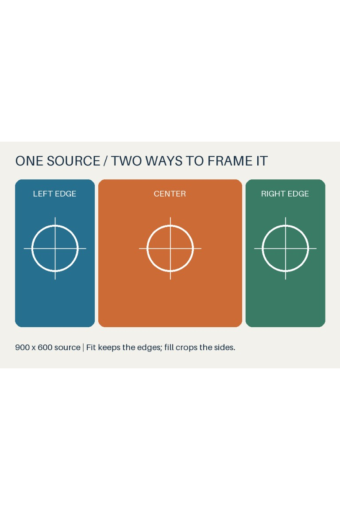
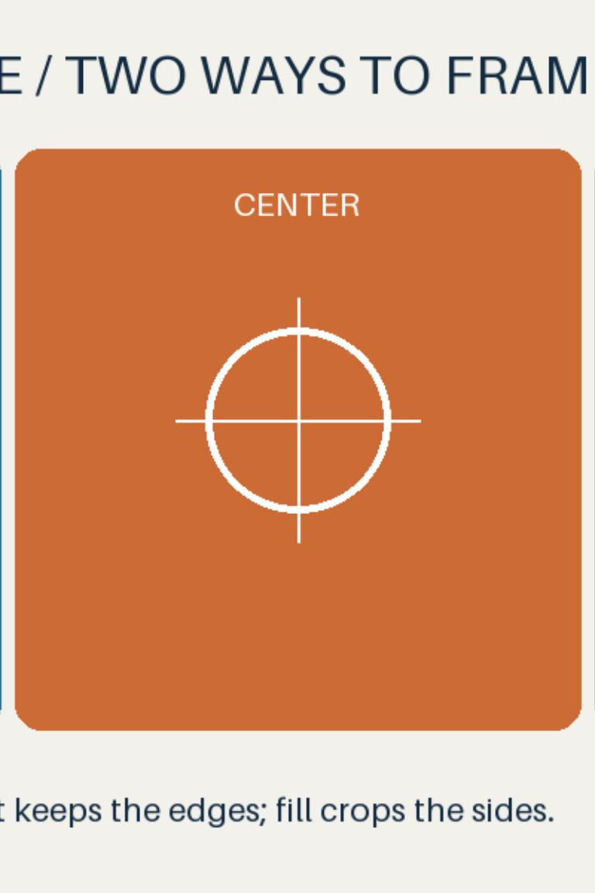

# Fit/fill example

This synthetic source and complete preview bundle were prepared offline with
`zink-prepare`, using the default quality 90 / 4:2:0 encoding. No private photo,
vendor profile or font is included. Nothing was sent to a printer.

| Fit: whole image with white padding | Fill: center crop |
| --- | --- |
|  |  |

The text and edge targets intentionally extend beyond the fill crop. Both
previews are decoded from their respective JPEGs. Fill is the selected output
in [image.jpg](prepared/image.jpg); the full bundle includes its uncompressed
[raster](prepared/raster.png), [manifest](prepared/manifest.json), and a local
[HTML comparison](prepared/preview.html). Download/open the HTML with its sibling
files; GitHub's source view does not render it as a page.

Reproduce into a **new** directory:

```sh
python -m pip install -e '.[images]'
python examples/image-preparation/make_source.py
zink-prepare examples/image-preparation/source.png logs/my-preview --mode fill
```

The source is 900 × 600. Fit scales it to 768 × 512 with 320 pixels of white
padding above and below. Fill uses a 1.92× scale and a central source crop from
`(250, 0)` to `(650, 600)`. These are digital dimensions, not physical paper-edge
calibration. See [API/CLI policy and options](../../IMAGE_PREPARATION.md).
