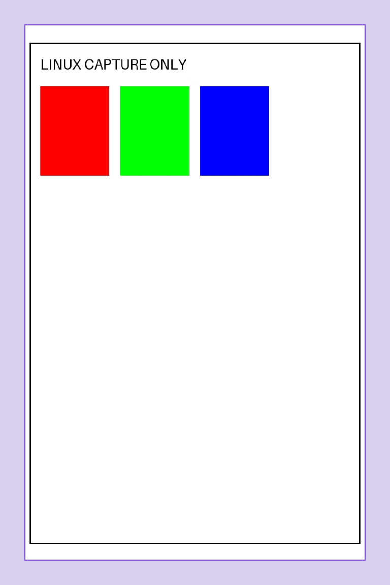

# ColorBerry Linux capture evidence

2026-10-26. Debian 12 ARM64, Python 3.11.2. No physical printer connection or
print. The [Linux queue guide](../../LINUX_PRINT_QUEUE.md) documents installation,
the registered capture queue and its limitations. The machine-readable
[validation summary](validation.json) contains no device identity or credentials.

## Actual system spooler

CUPS rendered synthetic PDFs into 1370 × 2055 sRGB pages. The capture worker
prepared 768 × 1152 JPEGs at quality 100 / 4:4:4, with all-one quantization tables.
Both preserved the complete raster in `[48, 72, 720, 1080]` with 48-pixel side
margins and 72-pixel top/bottom margins. JPEG hashes and exact decoded-preview
equality were independently checked after retrieving the evidence to macOS.

| Input | Prepared JPEG | Frontend outcome | CUPS outcome |
| --- | --- | --- | --- |
| Portrait PDF | 38,175 bytes | Captured/completed | Completed |
| Landscape PDF | 36,174 bytes | Captured/completed, rotated in the portrait raster | Completed |
| Two-page PDF | None | Aborted before worker invocation | **Completed: status mismatch** |

The two-page job's diagnostic raw page remains private, with no prepared payload
or worker claim. A read-only CUPS Get-Job-Attributes check independently confirmed
state 9 (`completed`) while the frontend retained state 8 (`aborted`). Resolving
that mismatch is a prerequisite for live Linux activation. No cause has yet been
assigned to CUPS, its IPP backend or the interaction between the two endpoints.

An earlier development check captured one portrait successfully but timed out
because its Get-Jobs query omitted the job-state attribute. That original capture
was retained; the corrected run produced the two successful captures shown here
and the deliberately rejected document. The installed capture directory therefore
contains three completed synthetic captures, not evidence of a retry to hardware.

## Native/service checks

- Native ARM64 build from pinned PAPPL/libcups source succeeded.
- Four direct IPP captures passed: fill/preserve-edges × Normal/High quality.
- Both cancellation cases passed using fake sleeping workers: 0.261 seconds for
  normal termination and 2.044 seconds when SIGTERM was deliberately ignored.
- Systemd user service enabled/running, listener restricted to loopback, no
  default-printer change, queue not shared, no active CUPS jobs afterward.
- An idle restart changed the process ID, preserved all 19 captured/diagnostic
  files byte-for-byte, retained terminal job history and did not replay work
  during a five-second observation after the listener returned.
- The ARM64 portable suite passed 662 tests with four optional-binding skips
  before two final guard tests were added; all eight final installer/guard tests
  then passed separately. No test opened Bluetooth. The host was not rebooted.

The initial service-manager inventory also showed unrelated failed desktop
metadata/audio services; they were not modified. Existing user lingering was
left as-is. Private logs and source/build staging remain on ColorBerry for
diagnosis. The repository contains only synthetic images and summarized results.

## Previews

[Plain portrait](portrait.png) · [Exact portrait JPEG](portrait.jpg) ·
[Plain landscape](landscape.png) · [Landscape guide](landscape-safe-area.png) ·
[Exact landscape JPEG](landscape.jpg)

The guide is absent from the JPEG. These captures validate Linux rendering and
placement, not physical paper margins, color, Bluetooth or print completion.

## Repository checks

Implementation: [`d9af97a`](https://github.com/qayshp/zink-probe/commit/d9af97a4aebdc264388e8df6fba916e720c0616e).
The local macOS suite passed 666 tests with two optional-binding skips, and lint
passed. The [native workflow](https://github.com/qayshp/zink-probe/actions/runs/40289536413)
passed on macOS, Linux and Windows. This retains the existing direct IPP capture
checks alongside the new actual ColorBerry CUPS evidence above.
The [portable workflow](https://github.com/qayshp/zink-probe/actions/runs/40289536042)
also passed all six macOS/Linux/Windows × Python 3.11/3.14 jobs, including the
new capture installer and optimization-resistant pre-submission guard tests.
