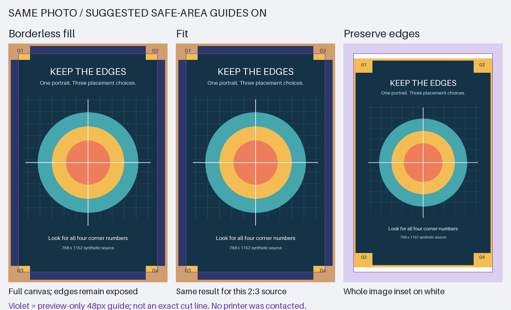

# Preserve edges: synthetic portrait example



This example deliberately uses a 2:3 source. **Fit and Borderless fill are
identical here:** neither leaves room for physical edge trimming. Preserve edges
keeps the complete source inside a conservative inset, including all four corner
numbers. The violet band and outline are preview guides, not part of the JPEG.

- [Interactive local comparison](prepared/preview.html): download/open with its
  sibling files to toggle guides. GitHub's HTML source view is not the preview.
- [Selected actual JPEG](prepared/image.jpg): quality 100, 4:4:4, 768 × 1152.
- [Plain decoded preview](prepared/preview.png) and [guided preview](prepared/safe-area-preview.png).
- [Manifest with geometry and hashes](prepared/manifest.json).
- [Calibration basis and limitations](../../PRESERVE_EDGES.md).

The photo area is 672 × 1008, with white margins of 48 pixels left/right and 72
top/bottom. This is a placement policy, not a promise of exact physical margins
or perfect edge retention. Nothing was sent to a printer. The source is entirely
synthetic, built with Pillow's bundled default font; no private image is included.

To regenerate, archive/remove only this generated `prepared` directory first
(the production bundle writer refuses overwrites), then run:

```sh
python examples/preserve-edges/make_example.py
```

The older [landscape fit/fill example](../image-preparation/README.md) is retained
unchanged as a historical fixture. Newly prepared bundles compare all three modes.
