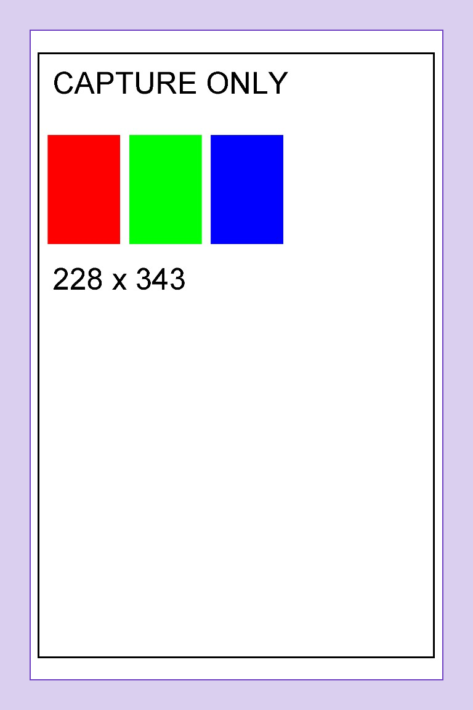

# Surface Preserve edges capture validation

2026-10-26. Installed **HP Sprocket Select (Preserve edges) (capture)** on Surface,
alongside the existing live **HP Sprocket Select** borderless queue. No Bluetooth
connection, settings change or physical print was made. The new queue remains
in capture mode; selecting it in an application's Print dialog saves a prepared
page locally and consumes no paper.

## What is installed

| Queue | Mode | Local IPP port | Runtime |
| --- | --- | --- | --- |
| HP Sprocket Select | Existing live borderless | 8631 | Original installation |
| HP Sprocket Select (Preserve edges) (capture) | Capture, Preserve edges | 8632 | Separate `preserve-edges` subdirectory |

Both use Microsoft IPP Class Driver and listen on `127.0.0.1` only. The new
per-user task is `ZinkProbe-Select-PreserveEdges`; it starts at logon. Its private
configuration contains `mode: capture`, `preparation_mode: preserve-edges`, and
no printer address or device identity. Its Python 3.12.10 ARM64 environment and
x64 native frontend are separate from the existing borderless runtime.

The native package came from the successful [cfa380e Windows build](https://github.com/qayshp/zink-probe/actions/runs/40222249266).
The wheel was built from `82d0862`, which contains that implementation and its
documentation follow-up. Installed package hashes were checked against the local
staging files; the hashes are in [validation.json](validation.json). PowerShell's
script policy initially prevented installation; the retry used a process-scoped
`-ExecutionPolicy Bypass`. No persistent execution policy was changed.

## Actual Windows spooler checks

Ran `native/Validate-CaptureQueue.ps1 -PreparationMode PreserveEdges`, which
verifies the capture configuration and running process before submitting only
synthetic pages to this named capture queue.

| Input | Outcome | Prepared JPEG |
| --- | --- | --- |
| One portrait page | Captured | 29,685 bytes, quality 90 / 4:2:0 |
| One landscape page | Captured, landscape content rotated within the portrait raster | 29,376 bytes, quality 90 / 4:2:0 |
| Two-page document | Aborted before any worker invocation | No prepared payload or claim |

Windows delivered 1370 × 2055, 8-bit sRGB PWG rasters at its advertised
600 × 600 rendering DPI. Both valid pages were placed completely in
`[48, 72, 720, 1080]` on the 768 × 1152 output: 48-pixel side margins and
72-pixel top/bottom margins. Normal quality is what this test application sent;
High quality is separately covered by the native CI capture tests.

The two successful receipts both say `captured` and `bluetooth_opened: false`.
The capture directory contains no engine journal or protocol frame trace. The
rejected two-page job left one 8,446,062-byte diagnostic raster and no worker
claim. Its Windows error item was removed after recording the failure; the raw
diagnostic remains private, so any future activation must explicitly inspect
and archive that capture data first. Both Windows queues are now idle and both
scheduled tasks are running.

Before/after checks found the original borderless configuration, journal,
binaries, incoming files, job directories, printer name/port/status, scheduled
task action and process identity **unchanged**. Its process was not restarted,
and it acquired no new job. Captured JPEG hashes and decoded preview equality
were independently checked after copying the synthetic evidence back to macOS.

## Actual captured images

The rectangle and colored blocks below were generated by the test application's
Windows drawing calls. The violet band is a **preview-only** guide; it is absent
from the JPEG. It marks the conservative 48-pixel boundary, not a guarantee about
physical trimming. The source photo framing remains the application's decision:
this queue cannot recover content cropped before the rendered page reaches it.

[Plain portrait](portrait.png) · [Exact portrait JPEG](portrait.jpg) ·
[Plain landscape](landscape.png) · [Landscape guide](landscape-safe-area.png) ·
[Exact landscape JPEG](landscape.jpg)

Local previews on Surface are under
`%LOCALAPPDATA%\ZinkProbe\preserve-edges\capture\jobs\<job-id>\preview.png`
and `safe-area-preview.png`. This report and its images contain synthetic test
content only. Private device identities, original live records and raw logs are
not published.

This confirms Windows installation, spooling and preparation. Physical output
from Preserve edges remains untested, and the queue has not been enabled for
live printing. The original borderless queue retains its earlier physical
acceptance evidence.
