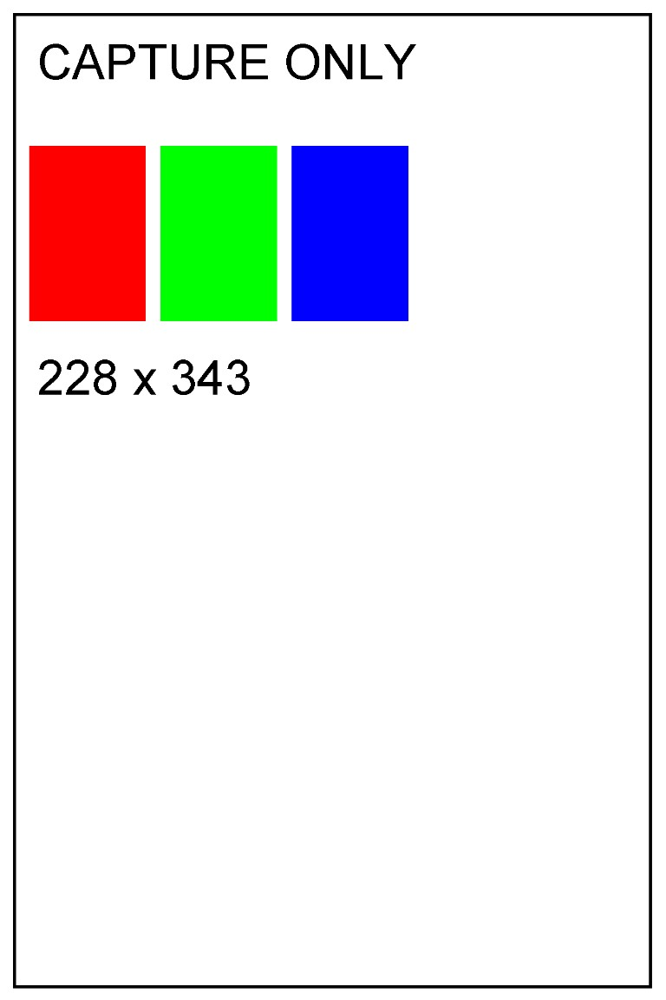
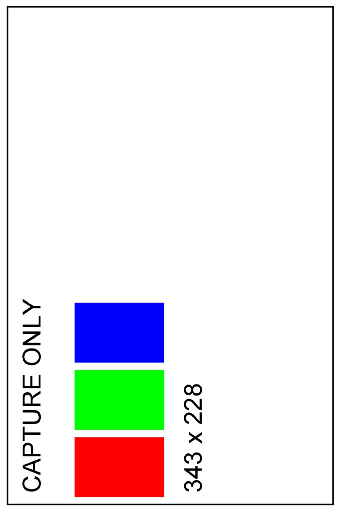

# Windows spooler capture examples

These images were rendered by Windows' **Microsoft IPP Class Driver** on an
ARM64 Surface, received by the local PAPPL queue as 1370 × 2055 sRGB raster,
and prepared by the Python worker at 768 × 1152, JPEG quality 90 / 4:2:0.
The PNGs below are decoded JPEG previews. **No paper was printed.** The capture
configuration contained no printer credentials and never constructed Bluetooth.

The small dimension labels use Windows PrintDocument's hundredths of an inch
(228 × 343 portrait, 343 × 228 landscape), not pixels. The media itself is
advertised as 58 × 87 mm. Landscape content is correctly rotated within the
fixed portrait-shaped printer payload.

| Portrait document | Landscape document on the same paper |
| --- | --- |
|  |  |

[`Validate-CaptureQueue.ps1`](../../native/Validate-CaptureQueue.ps1) generated
these synthetic pages through the Windows spooler. It also submitted a two-page
document **to the capture queue**; the native driver rejected that complete job
before invoking the worker, so there was no partial first-page dispatch.

See the [installation and operation guide](../../WINDOWS_PRINT_QUEUE.md) and
[sanitized validation record](validation-2026-10-25.json). Raw device identifiers,
protocol traces, local configuration and spool logs remain private.
