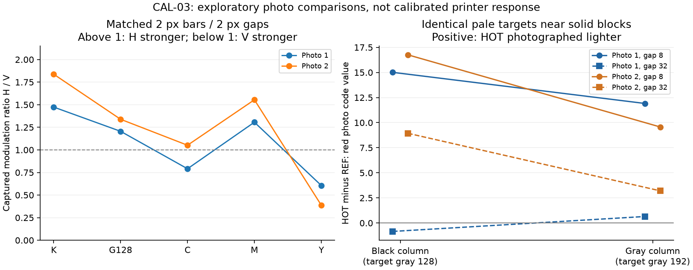

# CAL-03: two photographs after a reported 90-degree paper rotation

2026-10-24. The operator supplied two photos of the same quality-100 4:4:4
CAL-03 print, reported rotating the paper 90 degrees relative to the camera
between captures under similar lighting, and noted residual paper curl. The
backing remains attached. B / TWO emerged first in the completed print.
No printer connection, settings change or additional print was performed.

These are useful exploratory comparisons, not a calibrated measurement of
printer contrast, reflectance, color accuracy, native resolution or thermal
response. The numerical results below describe the combined print and camera.



## What persists across the photos

V bars run along the feed axis; their colored/white transitions run across the
head. H bars run across the feed axis; their transitions run along the feed.
The two-pixel bars separated by two-pixel white gaps provide a clearer initial
comparison than the nearly unresolved one-pixel patterns.

The table is the photographed H/V modulation ratio, measured in each color's
contrast-bearing channel. Above one means greater captured H modulation; below
one means greater V modulation. It is not a ratio of physical printer MTFs.

| Requested color | Photo 1, A-end 2 px pair | Photo 2, same pair | Interpretation |
|---|---:|---:|---|
| K, RGB black | 1.47 | 1.84 | H stronger in both |
| G128 | 1.21 | 1.34 | H stronger here; repeated B-end pair less consistent |
| C | 0.79 | 1.05 | This pair does not give a stable ordering |
| M | 1.31 | 1.55 | H stronger in both |
| Y | 0.61 | 0.39 | V stronger in both |

The repeated two-pixel pairs at the B end preserve the K/M/Y ordering in both
photos: K H/V=1.61/1.60, M=1.44/1.87, and Y=0.66/0.51. Requested RGB C/M/Y still
do not prove isolated activation of a particular dye layer.

For these patches, the exact decoded printed JPEG has equal V/H channel
modulation: 255 code values for K/C/M/Y and 127 for G128. Thus this directional
ordering is not already present as unequal modulation in the transmitted image.
Firmware resampling/color processing, thermal development and capture remain
possible contributors downstream.

The black one-pixel V patch has very little captured separation while its H
counterpart retains more. Widening the white gaps around otherwise unchanged
black two-pixel bars improves captured V modulation in both photos, and largely
closes the V/H difference. This is compatible with interactions between nearby
tracks, but ordinary blur/filtering and camera capture can also produce it.

Given the operator's reported physical rotation, persistent K/M/Y ordering is
less consistent with a single fixed camera-axis blur being the whole explanation.
The saved files both have orientation tag 1; that metadata does not independently
verify the physical rotation. Content-dependent phone processing can follow the
artwork even when it rotates, and lighting/focus/curvature still affect capture.

## The conditioning result is lighter, not darker

All four pale targets for each color are **pixel-for-pixel identical in the exact
decoded quality-100 JPEG**. HOT denotes the lane bracketed by solid color blocks;
it is not a measured temperature. With B leading, the block on the B side of
each target is encountered first.

At the short, eight-input-pixel gap, the pale targets in the K and G128 HOT lanes
photograph lighter than their adjacent REF targets in both images. For a simple
numerical description, the central target red-channel differences (HOT minus
REF, on the photographed 0..255 scale) are:

| Target / neighboring blocks | Photo 1 | Photo 2 |
|---|---:|---:|
| Gray 128 target / black blocks, gap 8 | +15.0 | +16.8 |
| Gray 192 target / gray 128 blocks, gap 8 | +11.9 | +9.6 |
| Gray 128 target / black blocks, gap 32 | -0.8 | +8.9 |
| Gray 192 target / gray 128 blocks, gap 32 | +0.6 | +3.2 |

Green and blue values support the short-gap lightening as well. Re-centering
from local target edges and independently moving each central sample by up to
one input pixel preserves the short-gap K/G128 sign. Dividing by nearby white
paper samples also preserves it. Neither check is a camera calibration or a
statistical confidence interval.

This does **not** support a simple claim that residual heat always makes the next
pale area darker. It is compatible with an image-history-dependent response,
possibly including compensation, but does not prove firmware overcompensation.
Phone local tone mapping/sharpening, spatial interactions, and residual lighting
or surface differences can affect the same comparison. The CMY differences are
smaller or less consistent and do not support a simple ranking of thermal loads.

The 32-pixel-gap K result differs substantially between photos. Both photos show
smaller K/G128 differences at gap 32 than at gap 8, but the gap pairs occur at
different page positions and swap lanes. Do not turn those values into a cooling
time, thermal decay curve, or driver correction coefficient.

## What curl and capture still prevent

A planar mapping can approximately locate patches but cannot flatten a curved
sheet mathematically. Curvature changes local focus, magnification, incidence
angle and reflected light. Absolute modulation of repeated patches changes
between the photos: for example, the black B-end repeat is stronger than its
A-end counterpart in photo 1 but weaker in photo 2. That cannot be confidently
assigned to printer warm-up or feed history.

A flatter capture would help quantify small differences and edge profiles.
Permanent adhesive mounting is unnecessary. Keep the backing on and support
the sheet on a clean flat matte surface, holding the blank edge margins flat
while leaving reference marks visible. A camera approximately perpendicular to
the sheet, broad diffuse light and consistent focus/exposure/white balance would
reduce some capture variation. Close-ups of the two conditioning rows and
matched 2/4-pixel K/M/Y patterns would add more than another print. A scan is
another possible measurement route if a scanner is already available, but no
new equipment or paper is needed for the present conclusions.

## Reproducibility, privacy and driver consequences

[Analysis data](package-v3/photo-analysis.json) retains photo hashes, dimensions,
manual corner landmarks, source-to-photo mappings, all 60 line-region
measurements per photo, target sample boxes, local-white comparisons and sample
shift ranges. Original 2880x3840 photographs and their camera metadata remain in
ignored `logs/calibration-photos/cal03/`; they are not redistributed.

The method uses approximate manual frame-cross coordinates, a projective mapping,
and bilinear numerical sampling at quarter-input-pixel increments. Oversampling
adds no image resolution. Line profiles average the central 32x32 input-pixel
area parallel to the bars, then measure their 95th minus 5th percentile in R for
K/G128/C, G for M and B for Y. Targets use a central 32x6 area after locating top
and bottom edges within a bounded neighborhood. Decimal output is computational
precision, not a measurement-uncertainty claim.

Run with the existing Pillow/NumPy/Matplotlib research environment:

```sh
python experiments/calibration/analyze_cal03_photos.py --photo-dir logs/calibration-photos/cal03
```

The script checks the exact printed payload hash, validates equal decoded target
pixels, checks registration arithmetic and target edge bounds, and regenerates
the JSON and scientific plot. It does not edit the photographs or access hardware.

These findings strengthen the case for preserving fine color detail in the
prepared JPEG and keeping optional image-quality experiments separate from
transport. They do not justify a universal sharpening, brightness or thermal
correction in the driver. Continue the portable-engine transport adapters while
retaining this sheet for further optional measurements.
