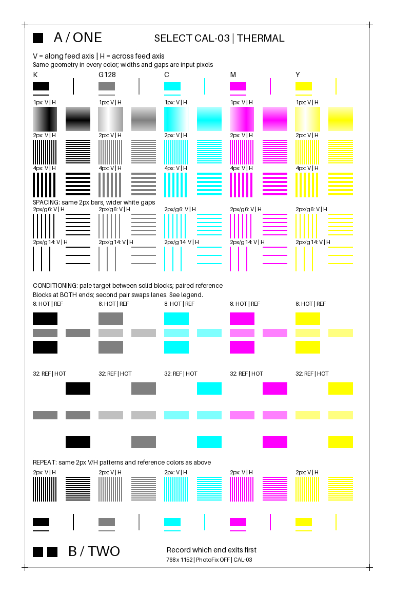

# CAL-03 quality-100 4:4:4 physical print

2026-10-24, America/Los_Angeles. The user authorized one CAL-03 sheet if a fresh
review found no further artwork changes necessary. The existing matched black,
gray, CMY, spacing, conditioning, repeated controls and end markers remained
useful, so the geometry was retained. Only the selected JPEG encoding changed.

**One complete image was uploaded, the page counter increased by one, and the
user confirmed successful emergence with B / TWO first.** This provides physical
acceptance evidence for this exact baseline quality-100 4:4:4 JPEG on the tested
G1L1FA2105AR Select. It does not establish a measured contrast improvement or
general support across all JPEGs, devices, firmware builds or color pipelines.



## Payload and offline checks

[Printed JPEG](../jpeg-quality/q100-444-optimized.jpg): **151,545 bytes**, SHA-256
`50b58d8cc26ba7349e7874861e8c76b16b4b0f5ac6d2962fa0051d970de83944`.
768×1152, baseline, quality 100, 4:4:4, optimized Huffman coding, PhotoFix omitted.
Its eight-bit quantization tables contain all ones. This remains a lossy JPEG.

The existing 163-patch geometry and six original-Android bitmap comparisons were
rechecked. The alternative encoding is produced by Python; it is not an Android
quality-100 encoding capture. All 20 repeated control groups decode identically
in this exact JPEG. The [quality-100 verification record](package-v3/quality100-verification.json)
retains all 60 line-pattern baselines. Existing quality-90 files and verification
records remain historical references; use the printed file for new measurements.

## Rejections before the successful transfer

The record includes two allocated job IDs, not a claim that every protocol step
succeeded on the first attempt:

1. The extended BLE inventory check failed with `Service Discovery has not been
   performed yet` after core status reads. A fresh basic BLE/RFCOMM preflight
   succeeded. No print mutation was made by either probe.
2. Job **13**, handle **4**, was allocated. The descriptive name
   `SELECT-CAL-03 Q100 444` was 22 bytes, exceeding the advertised **16-byte** limit.
   The sender had checked total message size but missed that capability field.
   The printer explicitly rejected the property request with `01 30 07`
   (invalid length). No image chunk had been sent.
3. A read-only reconciliation found idle/empty state and page count 11. A
   narrowly gated attempt to finish the same allocation used `SELECT-CAL-03`.
   An initial connection failure occurred before any correction mutation. On
   the subsequent connection, the shorter property request was acknowledged,
   but the first FileWrite to handle 4 was rejected with `01 0e 08` (illegal
   state). No image chunk was acknowledged. This is evidence against reusing
   that upload handle after disconnect, not a complete specification of handle
   lifetime for every condition.
4. After checking the exact rejection trace, unchanged page count, fresh identity,
   idle/empty state, and the advertised name limit, a separate bounded transaction
   allocated job **14**, handle **5**, and completed the intended single image.

The user had authorized one physical sheet. Recovery was selected explicitly
after definite rejections with zero acknowledged image chunks; no ambiguous
timeout caused an automatic print resubmission. Every attempt has a separate
persistent claim. The original rejected records and the CAL-02 record remain
intact. These special recovery flags are confined to this experiment; the new
portable engine never retries mutations or reuses disconnected handles.

## Successful transaction and completion

| Observation | Result |
|---|---|
| Printer firmware/model | G1L1FA2105AR / Select 0x48D3 |
| Job / upload handle | 14 / 5 |
| Job name / copies | SELECT-CAL-03 / 1 |
| Application-message limit | 1000 bytes |
| Accepted JPEG chunks | 152; at most 998 image bytes each; last 847 bytes |
| Start through final upload acknowledgement | 5.946 seconds |
| First sampled printing state | 8.170 seconds |
| Last sampled printing state | 62.578 seconds |
| First sampled return to idle and empty list | 64.672 seconds |
| Printed-page counter | 11 → 12 |
| Calibration-card counter | 2 → 2 |
| Configuration | Unchanged |
| Operator observation | Sheet emerged; **B / TWO first** |

Timings are host observations with about two-second polling, not precise paper
velocity or heater timing. The progress field again stayed zero. Battery status
changed charging → in_use → charging while the print ran; percentage was 100
during printing and 97 in the final samples. No battery-current measurement follows.

The [sanitized evidence](package-v3/print-evidence.json) includes the successful
start/property messages, all 152 file acknowledgements, status samples, events,
and a separate summary of the rejected transactions. An independent audit
reconstructed the exact payload hash, checked every acknowledged absolute offset
and total, confirmed one-copy metadata, and checked the other transmitted
commands against the existing read-only policy. Raw device identifiers and
frame logs remain private in ignored `logs/`.

## Interpretation and driver consequences

B / TWO is the bottom of the digital artwork. It emerged before A / ONE, so the
sheet's feed order runs from the larger source y coordinates toward the smaller
ones. Preserve this observation when comparing conditioning blocks and edge
tails. It does not establish the sign of every internal firmware coordinate.

The chart artwork itself needed no further change. The encoding upgrade avoids
the large known chroma-subsampling loss in one-pixel CMY patterns. A photograph
or scan can now be compared against this exact decoded JPEG; requested CMY still
does not prove isolated dye activation, and the print has not yet been measured
for contrast, color, or thermal effects.

The portable engine incorporates the practical lessons: validate UTF-8 job-name
bytes before allocation, preserve durable pending state, distinguish upload from
completion, and stop on lost acknowledgements or disconnected handles. Its
tests replay the sanitized successful CAL-03 acknowledgements without hardware.
Neither the engine nor the default image preparer silently changes to 4:4:4.

Reproduce local evidence, from the repository root:

```sh
python experiments/calibration/audit_cal03.py
python experiments/calibration/verify_quality100.py
```

The audit requires the private retained logs. Image verification requires the
Pillow/NumPy research environment; the public job-engine tests need neither
vendor binaries nor image-processing libraries. The sender's default invocation
only validates the hash. Its execution claims are spent and must not be removed
or reused to obtain another sheet.

The subsequent [two-photo analysis](CAL03_PHOTO_ANALYSIS.md) examines directional
color response and the conditioning controls. It retains the reported physical
rotation, paper curl, and capture limitations separately from protocol evidence.
