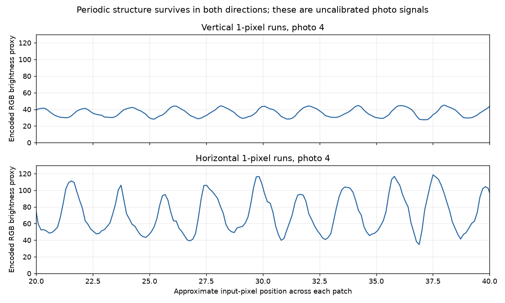

# CAL-02: close-ups refine the fine-detail finding

2026-10-22. The operator supplied four further 2880×3840 photographs of the
existing CAL-02 sheet. These improve the captured scale substantially. No further
print, device connection, setting change, or rendering run was performed. The
transmitted JPEG remains pinned to the hash in [FIRST_PRINT.md](FIRST_PRINT.md).

The main refinement to the [first photo analysis](PHOTO_ANALYSIS.md) is:
**the one-pixel vertical pattern survives as faint periodic structure; it has
strongly reduced contrast, rather than being demonstrably erased.** The first
wide photographs made that patch look almost solid. Photo 4 now reveals narrow,
regular vertical structure, while its horizontal counterpart has substantially
greater light/dark separation. This changes the interpretation from apparent
absence of detail to measurable survival of low-contrast detail in the capture.

## Checking whether the visible structure matches the intended pattern

An 80-pixel patch with alternating one-pixel black/white runs contains 40 complete
cycles. Alternating two-pixel runs contain 20 cycles. I sampled three interior
bands in each of photo 4's vertical/horizontal one-/two-pixel patches. Each band
averages 60 photo pixels perpendicular to the stripe variation, yielding a
brightness profile along the variation axis.

| Source patch | Expected cycles across 80 input px | Dominant cycles across approximate photographed patch span, three bands |
| --- | ---: | ---: |
| Vertical, 1 px | 40 | 39.96–40.20 |
| Horizontal, 1 px | 40 | 39.32–39.56 |
| Vertical, 2 px | 20 | 19.96–20.00 |
| Horizontal, 2 px | 20 | 19.85–19.87 |

These values support approximately 40 and 20 repeats, respectively. The exact
decimals are numerical output from approximate manual spans, not calibrated
frequency precision. In particular, 39-point-something does not establish a
missing printed line: the sampling span, perspective and dark/white boundary
placement affect the normalization. The strongest spectral component was sought
over a broad 5–100-cycle range, rather than only around the expected value.



The graph uses the middle band of each one-pixel patch and the same vertical
scale. Regular modulation is present in both. Across all three bands the vertical
one-pixel spectral half-amplitude is about 5.6–8.0 photo code values, versus
26.2–28.9 for the horizontal patch. These are descriptions of this photograph,
**not a calibrated printer contrast ratio or modulation transfer function**.
The two patches also have different mean brightness in the photo.

Brightness is approximated as `0.2126 R + 0.7152 G + 0.0722 B` on the encoded JPEG
channels. It is not linear light or measured reflectance. The profile is linearly
detrended, Hann-windowed and transformed with an FFT. Zero padding refines the
numerical peak location without adding physical resolution. No sharpening,
rectification, white balance, gamma correction or deconvolution is applied.

The decoded transmitted JPEG still contains full black/white one-pixel patterns
with mean 127.5. Consequently, the photographed loss of contrast is downstream
of image preparation and JPEG encoding. The camera's response, lighting and the
physical print response remain combined in these measurements.

## Other observations in the close-ups

- **Photo 1:** the 4/6/8-pixel bars in both orientations are clearly separated;
  the right-hand long gray strip and gray edge samples can be inspected in more
  detail. Subtle strip texture/banding is visible, but its cause is unidentified.
- **Photo 2:** the two-by-two-input-pixel checkerboard is distinguishable, as are
  all three isolated two-pixel cyan/magenta/yellow lines. Fine color detail is
  therefore present for these samples. Their width, edge softness and registration
  cannot yet be assigned to specific physical color layers or heater geometry.
- **Photo 3:** the vertical sine sweep retains visible modulation much further
  into its fine end than the wide photographs suggested. The neutral ramp's hue
  excursion and weak separation among the darkest steps remain visible. This
  does not provide an absolute resolution cutoff or a calibrated tone curve.
- **Photo 4:** one-pixel vertical lines are faint but regular; two- and three-pixel
  vertical patterns are clear. The horizontal patterns are clearer than in the
  earlier wide capture, without the same prominent dotted appearance in the
  two-pixel patch. This reinforces the need to separate capture artifacts from
  stable paper features.

Gray patches still look tinted and some nominally uniform areas have fine texture.
The images lack a calibrated color reference, and exposure/illumination differ
across captures. Neither a color correction nor a diagnosis of defective heating
elements follows. The photos also do not establish a controlled exchange of the
printed axes relative to the camera sensor; an upright saved image alone cannot
document how the phone and paper were oriented during capture.

## Consequences and remaining questions

1. **Keep the current 768×1152 raster preparation.** These photos do not justify
   downsampling the input or declaring one-pixel vertical information absent.
   They support preserved fine periodic content with substantial directional
   differences in the combined print/capture response.
2. **Do not compensate yet with sharpening or color correction.** Such changes
   require better separation of printer effects from capture effects. Geometry
   and a future safe-area/fit option remain the most directly supported driver
   improvement from this sheet; the earlier crop estimate is unchanged.
3. **Native DPI and heater count remain unknown.** Surviving periodic content at
   the submitted raster's finest alternating pattern does not identify native
   sample spacing or prove independent resolution of every arbitrary input pixel.
   The 2×2 checkerboard is additional useful evidence, not a count of heating
   elements. The earlier 768×1152 versus advertised DPI mismatch is unresolved.
4. **More paper is unnecessary for the next measurement.** The close-ups have
   supplied the missing magnification. A documented 90-degree paper rotation
   relative to the sensor, or a calibrated scan at both orientations, would help
   isolate directionality. Physical cross-to-cross and sheet measurements would
   quantify image placement in millimeters. Feed speed cannot be recovered from
   these static photographs.

## Reproduction

The original close-ups are retained locally under ignored
`logs/calibration-photos/closeups/`, separate from the first photo set despite
repeated filenames. Only their hashes, sampling boxes, numerical results, and
the brightness-profile graph are committed. No original photo or camera/location
metadata is published.

```sh
python experiments/calibration/analyze_closeups.py \
  --photo-dir logs/calibration-photos/closeups \
  --plot experiments/calibration/package-v2/closeup-profiles.png
```

The script verifies all four original photo hashes/dimensions and the transmitted
JPEG hash. [closeup-analysis.json](package-v2/closeup-analysis.json) records the
sampling boxes and all twelve profile measurements. Reproduction requires the
private originals and NumPy/Pillow; the optional graph also uses Matplotlib.

Validation passed for the four photo hashes/sizes, pinned payload, and repeated
generation of all twelve profile measurements. Synthetic 20- and 40-cycle signals
with a known amplitude and linear background verified the spectral calculation.
The existing CAL-02 verifier also passed the source/image hashes, repeats, bounds,
gauges and all six retained Android comparisons. Lint and formatting passed.
