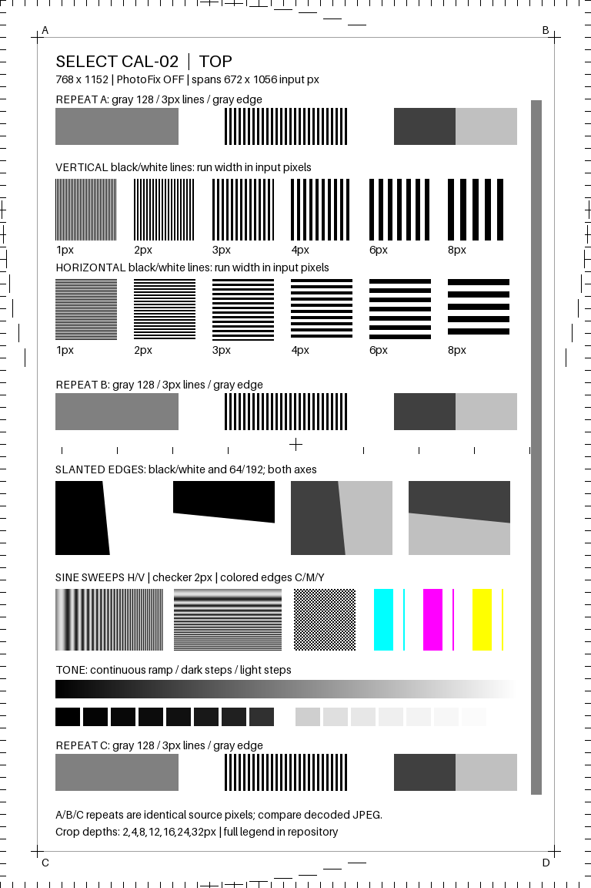

# First authorized CAL-02 print

2026-10-22, approximately 02:00 America/Los_Angeles (09:00 UTC). After reviewing
CAL-02, the operator explicitly authorized one sheet if offline checks passed.
Those checks passed and exactly one print job was submitted. **No second job,
reprint, reset, resume action, or configuration write was sent.**

The original no-print boundary is superseded only for this explicitly authorized
first sheet. The persistent attempt record remains in place; running the sender
again refuses a second attempt. Any later print needs new operator authorization.

## Image and validation

Payload: [Python JPEG](package-v2/python.jpg), 117,204 bytes, SHA-256
`14e1530787508578341510cbdf827352a604d19b1b14039fc3cf785e26078206`.
The image above is the digital source, **not a scan or photograph of the output**.
Both source and actual encoded JPEG, plus Android comparison images, are in Git.
See [revision details](REVISION_2.md) and the machine-readable
[evidence summary](package-v2/first-print-evidence.json).

All six original Android render cases were pixel-exact with Python; the JPEGs
were identical except for Android's ICC segment. Source repeats and chart bounds
were verified. Nine first-print transcript/failure tests, all 314 diagnostic tests,
and lint passed before connecting for the print. The rendering emulator was shut
down before physical printing.

## Physical protocol result

The fresh BLE/RFCOMM preflight and a further RFCOMM identity/status check identified
the same Select, firmware G1L1FA2105AR, model 0x48D3. It was idle, unpaused, at 100%,
with an empty job list, zero flags, and reported charging. Pages were 10 and
calibration cycles 2. Required commands and single-copy/name properties were
advertised. The actual target maximum application message was 1000 bytes.

| Observation | Result |
| --- | --- |
| Assigned job / file handle | Job 12, handle 3 |
| PrintStart requests | Exactly 1 |
| Job-property writes | Exactly 1; one copy; SELECT-CAL-02 |
| JPEG payload chunks | 118; maximum 998 bytes, last 438 bytes |
| Upload time, from before PrintStart through final acknowledgement | 3.805 seconds |
| First sampled printing state | 5.962 seconds from the same origin |
| Last sampled printing state | 60.661 seconds |
| First sampled return to idle/empty | 62.756 seconds |
| Page counter | 10 → 11 |
| Calibration-card counter | 2 → 2 |
| Final configuration | Identical to preflight |

These are host-observed timings, with approximately two-second status sampling.
They are not measurements of paper velocity, heater timing, or exact ejection time.
Independent trace audit reconstructed the uploaded bytes, verified the pinned
SHA-256, one-copy properties, every acknowledgement offset and target total, and
118 matching FileWrite replies ending in status 2. Remaining application requests
were checked against the existing read-only policy and discovered file handle.
Raw trace and device identities remain private under ignored logs.

The printer entered print status 7 with system flag 0x04 (`print_busy`), returned
to status 1/flags 0, and removed job 12 from the queue. The first post-upload
snapshot temporarily reported queue status empty even though ListJobs contained
12; separate requests are not an atomic snapshot. The printed-page increment,
job transition and unchanged calibration count support one completed image job.
At the time of this report, **operator confirmation of exactly one physically
emerged sheet and its appearance is pending**. No image-quality, geometry, feed
speed, or native-resolution measurement is claimed yet.

## Findings that affect interpretation and a future driver

1. This independently generated JPEG was accepted and the firmware reported one
   completed image job. Success is scoped to this unit, firmware, and payload.
2. No resume/clear-pause command was required in this idle/unpaused case. The
   device advertised trigger 2 (reboot), not trigger 1 (resume), and neither was
   sent. This narrows the earlier static app-path finding; paused-queue behavior
   is still untested.
3. The print-progress field stayed **0 throughout**, despite active printing and
   a completed page. A driver should not display that zero as reliable physical
   progress or infer a stall. Status, job identity, and counters were informative.
4. Battery status changed charging → in_use during printing → charging afterward;
   reported percentage stayed 100 during printing and became 98 afterward.
   Charger continuity is awaiting operator confirmation. If it stayed connected,
   this demonstrates the enum is not simply a USB-presence flag. It could reflect
   charging suspended under load, but current flow and electrical behavior were
   not measured. No battery-capacity estimate follows from the percentage change.
5. Four unsolicited target-event frames were captured, previously undocumented
   semantically on this unit:

   | Raw application bytes | Correlation; interpretation remains provisional |
   | --- | --- |
   | `03 08 00 0c 00` | Around upload completion; candidate event 8 + job ID 12 |
   | `03 01 00 07` | Entry into printing; candidate event 1 + print status 7 |
   | `03 06 00 0c 00` | Near job completion; candidate event 6 + job ID 12 |
   | `03 01 00 01` | Return to idle; candidate event 1 + print status 1 |

   A u16 event identifier followed by an event-specific payload fits all four
   frames. The inspected Android TargetEventMessage deserializer is empty, so it
   does not independently confirm this layout. Event 6 could mean completed or
   removed; one successful job cannot distinguish those semantics from cancellation.
   These frames were retained as evidence; no guessed decoder was enabled.

## Retained evidence and next measurement

Private files: `logs/cal02-preflight.json`, `logs/cal02-one-print-attempt.json`,
`logs/cal02-first-print-result.json`, and
`logs/20261022T090007-cal02-first-print.jsonl`. Public evidence contains sanitized
counts/timings/status samples and event frames, without serial/MAC/device identity.

Next, use the already printed sheet: confirm emergence/appearance, record which
edge emerged first if observed, and capture it flat with a calibrated physical
scale. The [measurement procedure](README.md#proposed-future-one-sheet-procedure--not-executed)
and blank worksheet remain applicable, using CAL-02's manifest for its additional
patches. Do not spend another sheet just to obtain a better photograph or scan.
