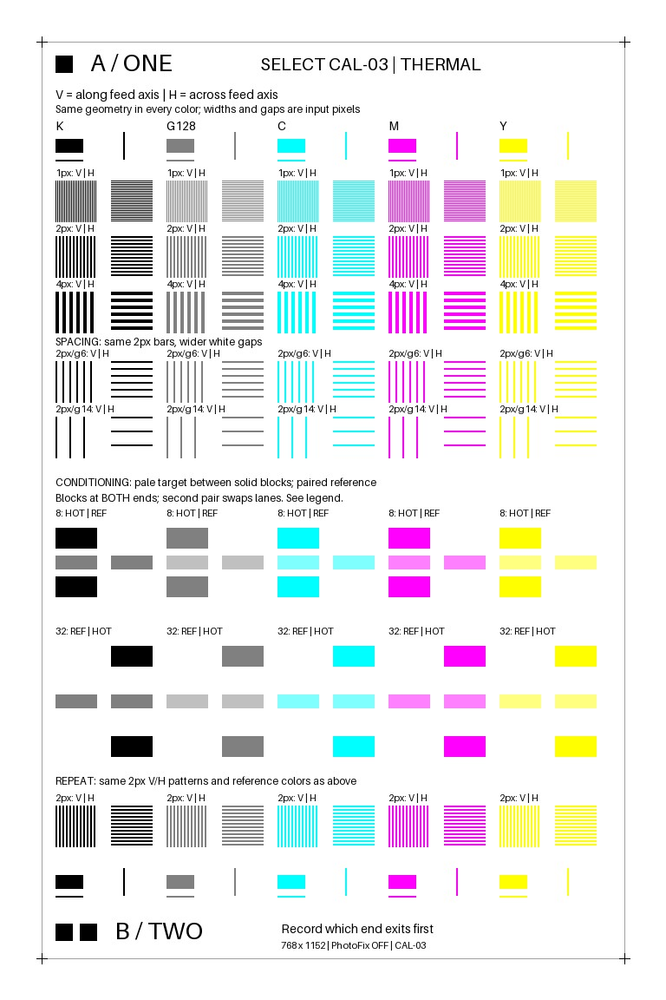

# SELECT-CAL-03: matched color and thermal-hypothesis controls

Prepared offline on 2026-10-22. **Update, 2026-10-24: CAL-03 printed successfully
at quality 100 / 4:4:4, with B / TWO first.** See [the print record](CAL03_PRINT.md)
and use its exact JPEG/reference baselines for measurements. The original
quality-90 preparation results below are preserved. The operator
requested preparation of a second chart after observing directional contrast
loss in CAL-02. This package does not add a printer command or change the spent
CAL-02 attempt record. The later physical test used a separate bounded sender.



## Why one more sheet could be useful

The first sheet established successful transport and visible output, approximate
image placement, and a directional difference in captured contrast. It did not
contain matched dense color patterns or controlled local conditioning. CAL-03
adds those comparisons to investigate the
[thermal hypotheses](THERMAL_HYPOTHESES.md), rather than repeating the broad
geometry/tone chart. This is a reasonable one-sheet follow-up for curiosity and
image-quality research. It is not a prerequisite for a usable driver, and a
single result cannot identify a thermal algorithm or justify compensation.

The first sheet is now attached to the operator's laptop as a commemorative
sticker. Existing photographs and measurements remain evidence. Any further
photographs should account for the new support surface, lighting and possible
flatness changes; there is no reason to detach or damage it for this experiment.

## Reading the chart

Five columns request K=(0,0,0), G128=(128,128,128), C=(0,255,255), M=(255,0,255),
and Y=(255,255,0). Each column has the same geometry. K denotes requested RGB
black, not a separate black dye layer. Requested C/M/Y do not directly command
individual thermal layers; the printer's color conversion remains involved.

| Region | Construction | Question |
| --- | --- | --- |
| Reference marks near both ends | Solid color, unoutlined white reference, isolated 2-pixel vertical/horizontal lines | What are the local solid/white levels, and does isolation change edge behavior? |
| First three patterned rows | 48×48-pixel V/H pairs; equal colored/white runs of 1, 2 or 4 pixels | Does the directional difference depend on requested color and feature width? |
| Spacing rows | Fixed 2-pixel colored bars; white gaps increased to 6 or 14 pixels | Do neighboring colored tracks affect the intervening white more than widely separated tracks? |
| Conditioning pairs | Identical pale targets; one lane has solid color blocks on both sides along the feed axis, its paired reference lane has white there | Does nearby/preceding coverage alter the same requested target? |
| Final patterned row | Exact repeat of the earlier 2-pixel V/H pairs | Is the result stable across positions on the page? |
| End identifiers | A / ONE with one square; B / TWO with two squares | Which labeled edge emerges first? |

V means the bars run parallel to the long/feed axis. H means they run across the
short axis, with variation along the feed direction. The feed axis was confirmed
by the operator; the later CAL-03 print confirmed B / TWO as the leading artwork edge.
All measurement patches and end squares are inside x=64..688 and y=64..1084,
well inward of the first sheet's approximate crop boundaries. The 672×1056-pixel
reference frame is retained. The candidate is 768×1152, with PhotoFix omitted and
no extra fit, scale, or crop compensation applied.

## Conditioning controls and their limits

Each pale target is 48×16 input pixels. Requested target RGB values are:
K→128/128/128, G128→192/192/192, C→128/255/255, M→255/128/255,
Y→255/255/128. Its neighboring solid blocks are 48×24 pixels in the column color.

The first pair uses 8-pixel white gaps and puts the conditioned lane on the left.
The second uses 32-pixel gaps and puts it on the right. Blocks bracket each target
so that a block precedes it whichever end prints first. The other block follows.
At the first sheet's approximate image scale, these gaps are about 0.63 and
2.52 mm; these are spatial separations, not measured cooling times.

HOT is a label for the lane with conditioning blocks, not a measured temperature.
REF is a relative reference: heat from neighboring tracks or the head assembly
can still reach it. Bracketing tests local conditioning, which may include both
history and spatial spread; it does not isolate a purely temporal mechanism.
The two gaps occur at different page positions and swap lanes, so a difference
between their effects cannot by itself yield a cooling constant. Compare HOT
versus REF within each pair first. The swap offers a check against a fixed
left/right bias, but is not a fully crossed factorial experiment.

All four targets per requested color are exactly identical in the source.
Decoded JPEG targets are also identical except for a maximum two-code-value
difference in the magenta group. The solid references and repeated line patches
are identical in both source and decoded JPEG. Their exact coordinates and
differences are retained in the manifest and verification results.

## Separate encoding effects from printer effects

The prepared JPEG follows the existing Android-compatible quality-90, 4:2:0 path.
Color subsampling changes fine color stripes before a printer sees them. The
following values measure the decoded vertical pattern's channel range relative
to its requested channel range, averaged over the central 32×32 input pixels.
For C/M/Y the sampled channels are R/G/B respectively; for K/G128, R is used.

| Colored run / white gap | K | G128 | C | M | Y |
| --- | ---: | ---: | ---: | ---: | ---: |
| 1 / 1 px | 1.000 | 1.000 | 0.298 | 0.588 | 0.118 |
| 2 / 2 px | 1.000 | 1.008 | 0.655 | 0.800 | 0.557 |
| 4 / 4 px | 1.000 | 1.016 | 1.000 | 1.000 | 1.000 |

These are encoded RGB measurements, not perceptual contrast, reflectance, dye
density or MTF. Slight values above one result from encoding differences. The
horizontal values and all spacing/repeat patches are also recorded. Use the
4-pixel pairs as the cleaner initial color comparison; the 1-pixel pairs are a
stress case with a substantial known encoding limitation. Even a full channel
range does not mean an unchanged edge profile. Compare photographs to the actual
decoded JPEG and normalize to each color's local solid and white references;
raw yellow-versus-black brightness contrast is not an appropriate comparison.

## Offline validation

Original HP Android classes from APK 3.0.2921.1 / 74251 rendered six cases in the
dedicated Android 16 ARM64 research emulator: override/file-Lanczos/file-matrix,
each with PhotoFix skipped/requested. The existing harness has no network or
Bluetooth permissions and does not instantiate a printer client. Bluetooth,
Wi-Fi and mobile data services were disabled. The original vendor app was not
launched. The emulator was shut down after capture and comparison.

- All six original Android bitmaps match Python exactly.
- All six decoded Android JPEGs match the Python JPEG exactly. Encoded bytes match
  after removing only Android's 474-byte ICC APP2 segment.
- Full original `processData` output matches the captured JPEG for every case.
- PhotoFix-requested results were unchanged for this chart; diagnostic native
  calls returned SUCCESS. The candidate remains the PhotoFix-omitted output.
- 163 non-overlapping measurement regions, 20 exact source repeat groups,
  transposed V/H geometry and conditioning positions pass the verifier.
- Decoded baselines for all 60 line patches are retained. Whole-image mean
  absolute channel error versus source is 2.222701, maximum 162, and 20.00642% of
  pixels change through JPEG encoding. The large local errors are a reason to
  use the decoded baseline, particularly for fine color patterns.

Python JPEG: **96,490 bytes**, SHA-256
`f21f5840422fc73f3b535ef3e69381d2a2d91b1ea3a4dce575076d38c68d4d48`.
Android JPEG: 96,964 bytes. The committed package includes source, Python and
Android PNG/JPEG outputs, manifests, comparisons and verification results.
Vendor binaries, private captures and logs remain ignored.

## Measurement procedure and execution update

1. The completed print used the separate quality-100 4:4:4 JPEG with PhotoFix off.
   Preserve that exact file and its decoded reference. The bounded claims are
   spent; do not reuse the CAL-02 or CAL-03 sender to obtain another sheet.
2. The user observed **B / TWO first**. Video was not required. This establishes
   the artwork's leading edge but does not measure exact paper velocity.
3. Photograph the whole sheet and close-ups under diffuse, consistent lighting.
   Keep the camera settings fixed where possible; record a 90-degree physical
   paper rotation relative to the camera sensor. Saved image orientation alone
   does not establish that rotation.
4. Start with four-pixel V/H pairs and HOT/REF target differences. Then inspect
   two-pixel spacing, isolated lines and repeated controls against the JPEG.
   Treat colored fringes as print-plus-capture evidence until capture effects
   are separated. Do not infer native heater count from these patterns.

If the result does not distinguish the hypotheses, retain the uncertainty and
move on to the portable driver work. Repeatedly spending sheets is not necessary
to implement discovery, status, preparation, job handling and OS adapters.

## Reproduction

Use the existing Pillow/NumPy analysis environment. From the repository root:

```sh
python experiments/calibration/build_chart_v3.py
python experiments/calibration/compare_chart.py logs/android-runtime/calibration-v3/files/results-calibration-v3 --package experiments/calibration/package-v3
python experiments/calibration/verify_v3.py
```

The original Android capture uses the existing
[permission-free emulator harness](../android-render/README.md), with this
`source.png` copied into private `files/calibration-source.png` and activity
extras `--es run calibration-v3 --ez calibration true`. It uses the existing
per-app pointer-tagging opt-out. Captured files are retained locally under
`logs/android-runtime/calibration-v3/`; no physical printer is part of this route.
