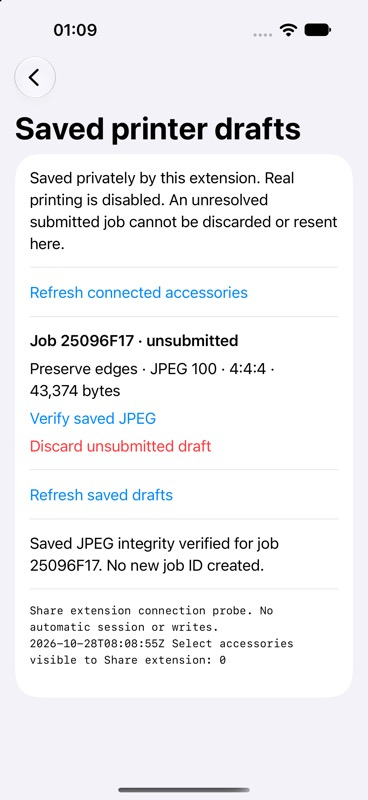

# Native iOS accessory adapter and durable binding — Build 13

This is the Build 13 read-only milestone. [Build 14](../authorization-tests/README.md)
adds a separate, explicitly confirmed one-job print path; the diagnostic/recovery
entry points and their read-only policy described here remain restricted.

**Implemented: native read-only EASession IO, full Share preflight, and saved
printer-bound drafts. Real printing is disabled.** Native adapter entry points
are full preflight and read-only saved-job recovery. There is no submit entry
point or UI switch that enables print writes.

## Ownership and output policy

`NativeAccessoryAdapter.swift` creates an EASession only for a connected HPISPSLE
advertising `com.hp.protocol.lifestyle`. `EADuplex` schedules both streams in the
main run loop's common modes. `AccessoryStreamDriver` owns reads, writes, timeout
ticks and one terminal closure, through the same interface used by offline tests.
Callbacks are serialized; partial writes and zero-write backpressure are supported.
Both streams must open within ten seconds. Each framed exchange has a ten-second
deadline, full preflight has a sixty-second overall bound, and recovery has a
180-second bound. Total input is capped at 256 KiB. Stream errors, EOF, cancellation,
disconnect, clock regression or lifecycle departure stop without reconnect/retry.

`ReadOnlyFrameGate` authorizes the entire outgoing HP+ frame before its first byte
can reach OutputStream. After a partial write, only the exact remaining suffix is
accepted. The fixed payload allowlist is:

| Request | Allowed payload, hexadecimal |
| --- | --- |
| Firmware, model, canonical device ID | `04 01`, `04 09`, `04 06` |
| Connection-local maximum negotiation | `24 00 10` |
| Capability handle and existing-resource read | `2a`; `28 <handle> 01` |
| Pause configuration read | `1a 04` |
| Selected status fields | `08 01 02 03 05 06 07` |
| Queued job IDs | `2c` |
| Dataset-1 counters with pagination | `3a 01 <iterator-lo> <iterator-hi>` |

PrintStart (`0c`), file writes (`0e`), job properties (`30`), clock writes (`18`),
configuration writes and interface selection are blocked before native output.
Unknown, malformed, concatenated or changed-continuation frames are also refused.
The guard has no enable flag. The native facade constructs only read operations;
tests additionally put a normal upload coordinator behind the guard to verify the
first print mutation cannot cross it. That blocked attempt retains its pending
journal record rather than becoming eligible for another submission.

## Full preflight from Share

Share one photo → **Select Probe** in the app row → **Connection test** → refresh
connected accessories → **Run full read-only preflight** for the Select. No session
opens automatically from sharing a photo. It checks firmware against accessory
metadata, Select model, canonical identity, setup, required capabilities/MIME/job
properties, name limit, pause state, battery/power, flags/state, empty queue and
page/calibration counters. Reports omit raw identity-bearing frames and device IDs.

The existing readiness policy remains strict. A time-invalid flag stops preflight;
it does not silently set the clock. Use the separately labeled main-app clock action
if appropriate, then rerun the check. A successful diagnostic discovers identity;
a saved-job check also requires the identity already in that binding to match.

## Durable draft binding

In preparation, tap **Bind a printer draft — no printing**. Review the frozen JPEG,
settings and one-copy count, explicitly run a full preflight, then tap **Save bound
draft — no printing**. Successful readiness evidence expires for binding after
sixty seconds; it is not a print permit and is never reused after restart.

The extension owns one fixed live store:
`Application Support/SelectLiveJobs/jobs.sqlite`. Its directory is excluded from
backup and uses iOS complete file protection; the database is also explicitly
protected. Locked/unavailable storage fails closed. In physical builds the resolver
refuses to use the containing app's container. The main app remains diagnostic-only,
so no App Group entitlement, provisioning change or shared-container fallback was
added. If the main app later owns jobs, it must share/migrate this store explicitly.

`prepared_bindings` in the same FULL-synchronous SQLite database stores one stable
UUID, canonical printer identity, verified firmware, JPEG SHA-256, exact byte count,
actual sampling, requested layout/quality, check time and the exact JPEG blob. They
commit atomically with one active reservation per printer. Reopening validates the
saved JPEG/hash/profile/geometry and does not invent a new ID or recompress it.
The existing `jobs` rows still track pending mutations, acknowledgements and outcome.
The bound-job coordinator constructor loads saved bytes and identity, runs fresh
preflight, and refuses changed firmware before claiming a job.

A second review or process cannot reserve the same printer while a draft/unresolved
job is active. **Saved printer drafts** lists those bindings and can verify bytes,
check the bound printer read-only, or reconcile a recorded job without loading an
upload plan. Only an unsubmitted draft with no job claim can be explicitly discarded.
Discard removes its JPEG blob and retains an inactive ID tombstone; it never clears
a possibly submitted job. Verified protocol completion releases the printer's active
reservation while keeping that job ID permanently used. This is local duplicate
protection, not a printer-side exactly-once guarantee across hosts or app-data deletion.

## Offline validation

```sh
mkdir -p build
swiftc ios/PrintCore/*.swift ios/accessory-tests/main.swift -o build/ios-accessory-tests
build/ios-accessory-tests
```

The suite uses generated sRGB JPEGs, temporary SQLite databases, virtual time and
an in-memory duplex. No Bluetooth/accessory connection or paper is involved.

- Full preflight with partial reads/writes, including one-byte fragments.
- Every one of the synthetic preflight's 77 outbound and 162 inbound byte-offset
  interruption positions. Failure produces no successful readiness proof.
- Opening timeout, zero-write backpressure, stream EOF, malformed reply, cancellation,
  owner release, deadline/clock failures and exactly one IO close with no later writes.
- Wrong identity/firmware and forbidden/modified outgoing frames.
- A saved-job coordinator attempting to print through the live output policy:
  zero PrintStart/file/property bytes reach the duplex; its journal stays blocking.
- Exact saved-byte submission through an explicitly supplied memory peer, protocol
  completion release, and permanent job-ID rejection.
- Restart round-trip, changed image/settings, stale readiness evidence, corrupted
  saved JPEG, discard restrictions, child-process exits after save and before the
  first mutating byte, and competing process reservations.

Existing coordinator, journal, Share-flow and preflight suites remain in CI.

## Verification boundaries

The simulator-only **Share adapter test** uses the exact photo/binding views and
stream driver, with an in-memory duplex and a separate `SelectLiveJobs-SIMULATOR-ONLY`
container path. Its generated draft was saved, listed and integrity-checked through
the UI, then reopened after rebuilding/relaunching the app with the same ID. The
saved-draft row uses independent button styles so verification cannot
also invoke its neighboring discard/check actions. The simulator harness and memory
preflight button are compiled out of physical-device builds.



Local accessory/binding, coordinator, journal, Share-flow and preflight suites
passed, as did iOS SDK core typechecking, the simulator build/run and the signed
iPhone app/extension build. App and embedded extension versions are both 13.
`devicectl` confirmed installation on the connected iPhone; installation did not
launch the app or run an accessory request. The user was asked to run the full
read-only preflight manually from Share and provide its report.

### Physical full Share preflight passed

User-supplied Build 13 report, 2026-10-28 08:12:22–08:12:23 UTC
(October 28, 01:12:22–01:12:23 America/Los_Angeles):

| Observation | Reported result |
| --- | --- |
| Select accessories visible | One, at initial and manual refresh |
| Native streams opened | Both (`Opened=2`) |
| Firmware | `G1L1FA2105AR`, validated against accessory metadata |
| Battery | 100% |
| Readiness | Idle, empty queue, no flags, not paused |
| Negotiated maximum / setup byte | 1000 / 33 (`0x21`) |
| Name limit | 16 UTF-8 bytes |
| Counters | 13 pages, 2 calibration cycles |
| Application bytes | TX=86, RX=469; identity bytes omitted from report |

The real Select completed the entire native Share preflight, including readiness,
capabilities, queue and counter queries. The output policy remained read-only and
the report explicitly says no print was authorized or sent. This is physical
extension evidence, separate from the earlier main-app preflight and Build 11
firmware-only check. No raw identity-bearing frames were provided or published.

The user then confirmed **Saved and verified** after following the physical Share
flow: frozen-photo draft review, explicit bound preflight, save, open Saved printer
drafts, and Verify saved JPEG. This establishes that the protected extension store
saved and loaded the bound draft and its JPEG passed the integrity check on the
phone. The user did not provide its job ID, image/hash, layout or byte count; none
are inferred or published. It does not establish reopening after process termination.

Still unverified physically: locked-phone behavior, actual accessory disconnection,
Share-host termination during an exchange, and reopening after extension termination.
Successful simulated stream events and SQLite process exits do not establish those
physical results. No new physical print is authorized here.

Before printing, verify these read-only paths on the phone, then separately review
how to replace the immutable live read-only policy with an explicit one-job print
permit bound to the stored UUID/JPEG/device. A future permit must not be recreated
after uncertainty. One deliberately authorized photo print would then test real
bulk transfer and completion observations; no further resolution chart is required.

Apple references:
- [EASession](https://developer.apple.com/documentation/externalaccessory/easession)
- [Extension containers and synchronized shared data](https://developer.apple.com/library/archive/documentation/General/Conceptual/ExtensibilityPG/ExtensionScenarios.html)
