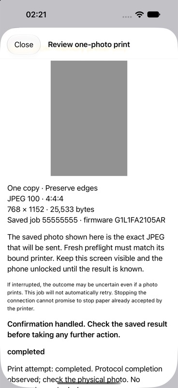

# One-job iOS submission — Build 14

The app is prepared for one deliberately confirmed photo-print attempt. **No
physical iOS print was performed while building this milestone.** The full native
Share preflight and bound-draft save/integrity check were physically verified in
Build 13. Bulk image transfer, real completion observations and physical ejection
from iOS still need the first controlled print. The implementation is experimental.

## First attempt on the phone

1. Keep the Select awake and nearby, with no competing active app/computer session.
2. Share one photo → **Select Probe** in the app row → **Connection test** →
   **Saved printer drafts**. An existing draft is available if retained from Build 13.
3. Check that the draft is the photo you want. If it was just a test image, discard
   that **unsubmitted** draft first. Return to preparation, choose your photo/layout,
   use quality 100, then **Bind a printer draft — no printing**, run the explicit
   read-only check and save. Saving still uses no paper.
4. Open **Review one-photo print**. Inspect the exact saved JPEG preview, layout,
   quality, sampling, byte count, firmware and job ID. One copy is fixed.
5. **Print this photo once to Sprocket Select** is the physical-print confirmation.
   It records a one-attempt authorization, opens native streams, and performs fresh
   full preflight against the saved identity before any print command.
6. Keep Share visible and the phone unlocked until the result is known. Do not
   navigate away or press Done during the transfer. Observe whether a photo emerges.

Read-only diagnostics never grant a print permit. No print starts on sharing,
preparation, saving, review, reconnection, view appearance or app launch. An absent
accessory must be connected through the main app/Settings before confirming.
Clock-invalid preflight still stops; clock sync remains a separate main-app action.

If interrupted or uncertain, **do not create another copy to retry**. The same job
cannot be authorized again. Saved printer drafts offers read-only reconciliation
where the recorded remote job ID permits it. A printer may finish after the phone
loses its connection. Stop connection closes the streams; it is not a verified
physical printer-cancel command. Protocol completion is not proof of physical ejection.

## Durable authorization and restricted output

`JobJournal.authorizePrintOnce` checks the exact immutable metadata shown in review,
validates the saved JPEG, and commits one `print_attempts` row in a FULL-synchronous
transaction. A competing confirmation or reopening cannot issue another permit.
The returned `PrintPermit` cannot be decoded/recreated from that row; it has a
locked one-use in-memory state and a guarded SQLite reserved → started transition.
There is no reusable/global print permission.

`NativeAccessoryAdapter.submitOnce` is called only by the confirmation button.
The normal coordinator loads the saved bytes/identity and rechecks readiness and
firmware. `SingleJobFrameGate` then permits only:

- The existing read-only preflight/observation payloads.
- One journaled PrintStart for the saved JPEG's exact size and JPEG MIME.
- Journaled properties for that remote job, exactly one copy and the fixed name.
- Journaled FileWrite payloads matching the saved JPEG slice, acknowledged offset
  and handle, with an optional single empty final at end-of-file.

The pending request's digest/opcode, job/image/device identity and firmware must
match before any mutating frame byte reaches OutputStream. Only exact remaining
suffixes are allowed after partial writes. Already used mutation positions cannot
be replayed. Clock/configuration/factory/firmware commands remain blocked. Native
diagnostics/recovery use the unchanged `ReadOnlyFrameGate`, not the print gate.

The owner serializes stream events, supports backpressure and fragmented replies,
and closes once on completion/error/cancellation. UI progress publishes changed
values only. The result sheet owns its state independently of the list row, so
archiving a completed draft does not remove its active result screen.

Each exchange is bounded to ten seconds and the entire attempt to 300 seconds,
including opening both streams within ten seconds. Cumulative print-session RX is
bounded to 32 MiB; individual frames retain the 4096-byte payload bound. No retry,
reconnect, resume, background transfer or automatic clock sync is added.

An orderly failure with **no job claim** records `notSubmitted`; this proves this
core generated no mutation. That spent job ID cannot be reauthorized, but the user
can explicitly discard the unsubmitted draft. Any claim/pending mutation remains
uncertain and cannot be discarded. An abrupt exit with reserved/started permission
also stays blocked; absence of an acknowledgement is never treated as permission
to resend. Verified completion releases the printer reservation but permanently
retains that job ID and authorization history. Another explicitly prepared UUID
is another job/copy, not a retry of the previous one.

This protection uses the extension's existing fixed, protected, backup-excluded
store. No physical store or user draft was cleared during testing. Deleting app
data, another database/host or changing this implementation bypasses local safeguards;
the printer does not provide an exactly-once contract.

## Offline tests and simulator UI

```sh
mkdir -p build
swiftc ios/PrintCore/*.swift ios/authorization-tests/main.swift -o build/ios-authorization-tests
build/ios-authorization-tests
```

Tests use an actual generated sRGB JPEG, temporary SQLite journals and an in-memory
duplex through the same stream driver/print gate used by native submission. They
cover successful one-copy/exact-byte transfer, one-byte fragments, optional empty
final, lost start/properties/final replies, wrong printer, paused preflight,
cancellation after PrintStart, every first-mutation frame prefix, read-only recovery,
reuse refusal, review mismatch, failed authorization storage, four abrupt process
exits (reserved, started, pending and uploaded), and competing process confirmations.
Existing coordinator/journal/accessory/Share-flow tests remain in CI.

The simulator-only **Saved print test** opens the actual saved-draft/review views.
Its confirmation uses a fixed in-memory duplex, never EASession. A synthetic draft
can be seeded with the test executable's `prepare <simulator-only-jobs.sqlite>`
mode. Production builds contain neither that entry nor the memory-print button.
UI simulation reached completed with the same saved UUID, full acknowledged JPEG,
one consumed confirmation, and a result sheet that remained visible after archival.
Synthetic simulator fixtures were isolated/reset for UI runs; those are not live
printer journals. No uninstall or physical-store reset is performed for the update.



The simulator UI is not a physical Share-host lifecycle test. Locked-phone behavior,
actual disconnection during upload, extension termination and physical completion
remain separate evidence to collect. The first attempt should stay in the foreground.

Local suites and iOS core typechecking passed, as did the simulator build/run and
signed physical iPhone app/extension build. `devicectl` confirmed installation of
Build 14; both embedded bundle versions are 14. Installation did not launch a
session or submit a print. The physical first attempt remains user-initiated.
