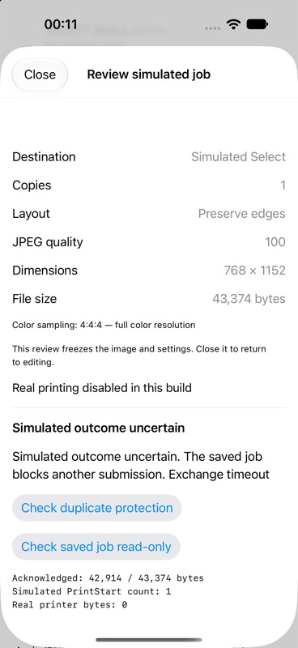

# Confirmed Share-flow simulation — Build 12

This records the Build 12 milestone. See [Build 13 native adapter and durable
binding](../accessory-tests/README.md) for the subsequent read-only integration.

The Share extension now wires the complete submission coordinator to an immutable
review and explicit confirmation screen. **Real printing remains disabled.** The
simulation actor owns its memory peer privately and accepts no transport callback,
accessory or destination selector. Sharing, preparing and reviewing create no job
and send no simulation requests. The existing manual firmware connection test is
independent and unchanged.

## Automated checks

Run from the repository root on macOS with Xcode's Swift toolchain:

```sh
mkdir -p build
swiftc -parse-as-library ios/PrintCore/*.swift ios/share-flow-tests/main.swift -o build/ios-share-flow-tests
build/ios-share-flow-tests
```

The tests use a generated 768 × 1152 sRGB JPEG, temporary SQLite store and virtual
time. They cover:

- No job database or requests before explicit confirmation.
- Successful full preflight/upload/completion, lost final reply and disconnection
  during upload. Exactly one simulated PrintStart per submitted scenario.
- Repeated/concurrent confirmations rejected; a second runner reopening the same
  ID is blocked. Invalid JPEG or unusable storage refuses before any request.
- Cancellation before confirmation and during upload; no requests after stopping.
- Read-only recovery of uncertain jobs without another upload or PrintStart.
- Zero real-printer bytes in every scenario. This follows from the fixed memory
  destination; it is not a measured Bluetooth capture.

The suite runs in iOS CI. The broader coordinator/journal suites continue to cover
framing faults, storage failures, multiple claims, abrupt child-process exits and
recovery at mutation boundaries. These are deterministic protocol simulations,
not firmware emulation or physical-device print tests.

## Simulator UI verification

The simulator build includes a **Share simulation test** entry that
passes a generated PNG to the exact `SimulationPhotoFlow` used by the extension.
This entry is compiled out on physical iPhones. The app and embedded extension
also compile for the iPhone SDK with extension-safe APIs enabled.

Verified through the running simulator UI:

- Preparation → Review opens a confirmation sheet with frozen JPEG preview,
  Preserve edges, quality 100, dimensions, actual sampling and exact file size.
- Awaiting confirmation is visible; the destination is Simulated Select, copies
  is one and real printing is explicitly disabled.
- Confirming the successful scenario reaches Simulation completed.
- Check duplicate protection reports that a second simulated job was blocked.
- Selecting Lose final reply reaches Simulated outcome uncertain, retaining one
  PrintStart and fewer durable acknowledged bytes than the JPEG's total length.



The simulator exercises the same view/runner source in the main-app harness, not
the actual remote Share-extension process. The Build 11 physical extension session
and firmware read remain separate evidence. Build 12 has not been installed or
tested on the user's iPhone in this milestone.

## Storage and duplicate-prevention scope

The simulation database lives in the current container at
`Application Support/SelectSimulation/SIMULATION-ONLY.sqlite`. Every review has a
stable job UUID and its own virtual printer ID, separate from any physical identity.
The permanent local-ID claim prevents re-confirming that review. Starting another
review creates another virtual target; this UI is not a test of concurrent real
jobs for the same printer. The coordinator's other suites test that constraint.

The journal stores fingerprints, counters and state, not the image. It never
automatically resumes after termination. There is no saved-job browser or shared
App Group store. Read-only recovery currently applies to the confirmed review in
the current UI; reopening the database alone cannot submit anything.

## Before a real iOS print

1. Choose durable live storage and lifecycle ownership. Bind one saved job and
   its frozen JPEG to the actual canonical printer ID. App/extension access must
   use the same live store if both can submit; app uninstall/storage removal and
   other hosts cannot be solved by a local SQLite claim.
2. Add the native EASession submission adapter, driving the coordinator serially
   with partial writes, framed reads, monotonic deadlines and terminal closure.
   Bind the explicit confirmation to that printer, image and one-copy job. Keep
   the live path separately gated from simulation and clock sync separate.
3. Test the complete extension preflight on the phone. Main-app preflight and
   extension firmware reads passed physically; full extension preflight has not.
4. Verify foreground Share-host cancellation, host dismissal, interruption,
   memory use and journal recovery on the phone. Short firmware reads do not
   establish that a larger transfer survives the extension's lifetime.
5. With explicit authorization, print one chosen photo and check transfer replies,
   completion/counters and physical ejection. Real firmware timing and observed
   print states may require conservative tuning; timeout must remain uncertain,
   never trigger automatic resubmission.

A controlled print is valuable once these integration gates are met: it tests
iOS bulk transfer and end-to-end delivery, which simulations cannot prove. A print
now would require connecting a live submission writer that this build deliberately
does not contain. It would add paper cost before resolving those integration gaps.
Another resolution chart is not needed to validate this software path.
